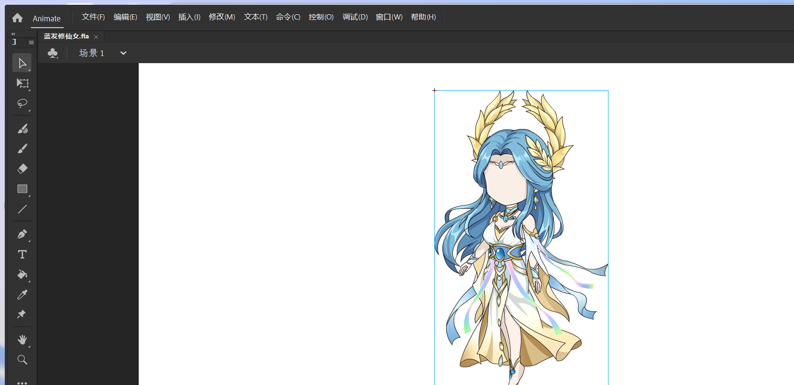

# Issue #757: Blue-haired FLA evidence

This evidence records two separate findings for `D:\表情合集\新人物\蓝发修仙女.fla`: the complete `com809` root was omitted from the default product catalog, and the red Scene overlay came from static vector mask fills that Animate treats as clipping geometry.

## Owner-viewable images

| Evidence | Image |
| --- | --- |
| Source opened in Adobe Animate, Scene 1 |  |
| Product Scene frame 0 after the change |  |
| Product preview of the complete `com809` root, frame 0 |  |

The source reference is an agent-captured Animate view. The two product images were rendered through the formal Main-process FLA import, snapshot catalog, preview, and hidden-renderer rasterization path. They are evidence for owner review; the owner has not yet recorded HUMAN VISUAL PASS.

## Source-backed diagnosis

- Original source SHA-256 before and after inspection/render: `86eb123fdd42f1dac80754c9260b793404072be70523b41d012598138c35c6d2` (3,179,910 bytes). The FLA was not modified.
- Strict ZIP preflight rejected the source's over-declared EOCD central-directory size. The existing bounded in-memory recovery path classified this as `RECOVERY_EOCD_SIZE_DECLARATION_ONLY`, reconstructed the boundary, and proved the exact duplicate local record; normalized bytes were 3,179,910 bytes with SHA-256 `0b0c146f4f9bee5c336a2f8b3f8da92927111b2ee2adb9540afd2ab970a1b519`.
- Scene timeline 0, frame 0 directly references Graphic `神女-cilisucai.com/神女-cilisucai.com809`, frame 0. That symbol has 30 frames and nested display elements. It was previously ranked beyond the default 64-entry catalog cap, so users could not select the complete root.
- The Scene red overlay is a separate issue. The reachable frame-0 graph contains 200 mask layers. Each has a red filled vector shape and a linked normal layer below it, identified by `parentLayerIndex`. Adobe documents that a mask's shape defines the reveal region and its color/transparency is ignored. The new static-vector path uses those shapes as clipping geometry and omits the mask fill from artwork. See [Adobe Animate mask layers](https://helpx.adobe.com/uk/animate/desktop/animation/using-mask-layers.html) and [Adobe Animate timeline layers](https://helpx.adobe.com/animate/desktop/workspace-and-workflow/timeline-layers.html).

## Result and regression evidence

- The Scene-referenced `com809` root is now promoted into the default frame-zero catalog when it would otherwise fall beyond the 64-entry cap. Previously selected candidates retain their order; the root is available at catalog entry 64 with stable target ID `fla-render-target-71289be86ab338b9c728b476f628b5708ec035560586326cc48e6af8eacfe8dd`.
- The product catalog returned 64 entries and reported 626 omitted candidates. The Scene target and `com809` frame 0 are preview-supported and non-blank.
- Scene preview: 1280×720, 184,590 bytes, SHA-256 `156117e21438ca956c95dea6c674d7582e8a0075a3a65bcf29b15bb94c311d6d`.
- Complete root preview: 274×466, 134,548 bytes, SHA-256 `d9e423464791a179de7766c7eb9b5aec0845bf0b64bd898c749f0f0dd8a25ed5`.
- #762 authored-state catalog regression comparison against parent `63ea029`: Hanfu remained 35/35 entries with identical order; Qingling remained 64/64 entries with identical order. No target IDs were added or lost, and both source files' SHA-256 values were unchanged.
- The targeted Stage D Electron smoke exited 0. It verified preview/selection and cancellation without project mutation, one confirmation followed by one committed static-snapshot asset, and an advanced project revision.

## Validation already run

- `pnpm typecheck`
- `pnpm lint`
- `pnpm test:unit` — 347 files, 2,515 tests passed
- `pnpm test:integration` — 38 files, 189 tests passed
- `pnpm build`
- Focused Vitest: `fla-static-snapshot-svg-builder.test.ts` and `fla-static-snapshot-display-list-adapter.test.ts` — 33 tests passed
- Targeted ESLint for the four changed source/test files
- Electron: `pnpm exec electron scripts/verify-issue396-stage-d.cjs --issue762-profile --acceptance-root 'D:\PandaStage-Acceptance\issue757-stage-d-smoke-20261012'` — exit code 0

Static vector masks are supported by this bounded path. Animated masks, shape tweens, non-vector masks, text, filters, and ActionScript remain unsupported/fail-closed. Human Windows Electron acceptance and owner visual review remain pending.
