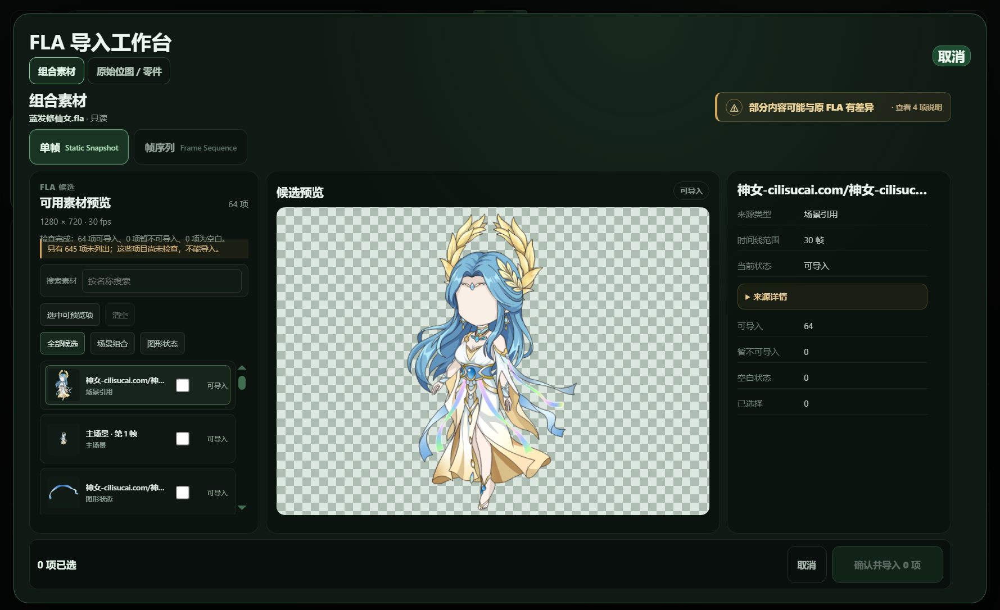
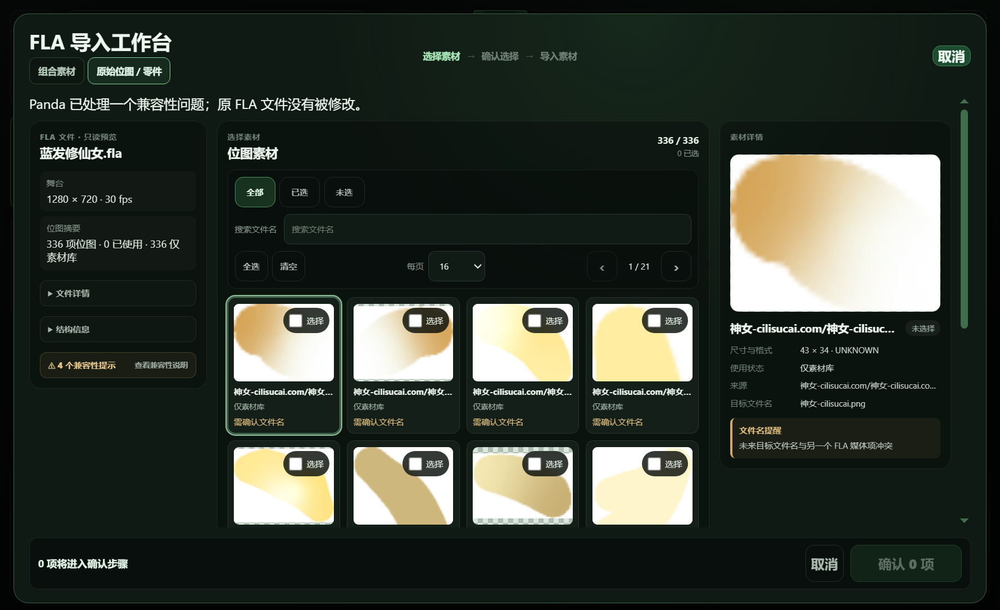

# Issue #767 U2 — Candidate Directory Evidence

**Status: engineering PASS; owner review pending. U3 was not started.** This run exercised the production Asset Library action and unified FLA workbench in Windows Electron. It did not import assets.

Run: `2026-10-13T04-29-01-877Z` · branch `issue-676-p0-c01-display-list-resolver` · HEAD `88a6cf7c2d1b6a2673cfc35b9d4694f043bfcb9c`.

## Real-source catalog results

| Source | Catalog | Scene | Scene-referenced Graphic | Authored Graphic state | Omitted at 64 cap | Supported, nonblank |
| --- | ---: | ---: | ---: | ---: | ---: | ---: |
| Bluehair | 64 | 1 | 1 | 62 | 645 | 64 |
| Qingling | 64 | 1 | 9 | 54 | 4 | 64 |
| Hanfu | 35 | 1 | 1 | 33 | 0 | 35 |

The normal UI request set `includeAuthoredStates: true` for every catalog. Bluehair's first visible entry is the exact `神女-cilisucai.com/神女-cilisucai.com809` Graphic, frame 0, role `scene-referenced-graphic`, target ID `fla-render-target-71289be86ab338b9c728b476f628b5708ec035560586326cc48e6af8eacfe8dd`. It is supported and nonblank. Its distinct full preview is 274 × 466 and hashes to `d9e423464791a179de7766c7eb9b5aec0845bf0b64bd898c749f0f0dd8a25ed5`, matching the accepted #757 frame-0 reference. Thumbnail and full-preview resources are separate. All 64 catalog IDs are unique. Candidate role filters show 62 Graphic states and 2 compositions, then restore all entries.

The visible cap warning accurately says 645 Bluehair and 4 Qingling candidates were not listed or inspected. It does not describe those omitted candidates as importable. Hanfu is below the cap.

## Raster, vector, cancellation, and unsupported controls

- Bluehair retains all **336** raw bitmap fragments in the secondary section, initially **0 selected**. The screenshot shows page 1 of 21; opening the raw section did not request a composition catalog. Switching to the composition section used the same inspection session.
- A generated raster-only FLA with two byte-identical PNGs retains two distinct source IDs, starts with 0 selected, requests no composition scan on first open, and returns an empty 0-candidate catalog with 0 omitted.
- A generated vector-only FLA enters the same workbench and returns one supported, nonblank Scene preview at 640 × 360.
- A generated missing-bitmap FLA returns two unsupported, nonblank candidates. Both are nonselectable and unselected; the catalog carries the precise reason `Bitmap media was not found: missing-library-bitmap.png`. Expanding “更多说明” shows the bounded user-facing explanation.
- Canceling while the Bluehair catalog request was in flight closed its session; the later response returned `SESSION_NOT_FOUND`. Reopening created a fresh session and rediscovered the exact com809 frame-0 ID without stale candidates or default selection.

## Source integrity

| Source file | SHA-256 before and after |
| --- | --- |
| `蓝发修仙女.fla` | `86eb123fdd42f1dac80754c9260b793404072be70523b41d012598138c35c6d2` |
| `青绫修仙女（四视角）.fla` | `d0958d4432decbf6c54566ba15a2f5e97bd88c82d75dcb2f84603e9b2273f0e4` |
| `汉服修仙女.fla` | `6af14990029d4ced2c4e305721321835180c1bf041178a8799e1d14a1f62e535` |

All three real source hashes matched before and after. The isolated project stayed at 0 assets with the same `project.json` SHA-256 (`04bdd4d2b1f6dd53125b204b880448f1559b6db499fbcf124516b3859b4ae58b`); no import was committed.

## Performance and responsiveness

Times below start when the composition directory is requested. “List” and “full preview” use the same event marks as the historical #766 receipt. “Ready” means the candidate preview scan finished for the listed catalog.

| Source | This run: list / full preview / ready | #766 list / full preview | This run: Main max heartbeat gap | #766 Main max gap | Renderer max gap | Windows Responding |
| --- | ---: | ---: | ---: | ---: | ---: | ---: |
| Qingling | 18.335 / 18.962 / 34.520 s | 20.718 / 22.418 s | 1.476 s | 1.465 s | 194 ms | 36 / 36 samples |
| Hanfu | 22.793 / 23.399 / 42.860 s | 24.773 / 25.621 s | 2.851 s | 2.801 s | 152 ms | 21 / 21 samples |

The historical UI timings are from the prior Windows Electron observations recorded for [Issue #766](https://github.com/Cognitive-Architect/panda-stage/issues/766); the historical scan-only totals are from [Issue #762](https://github.com/Cognitive-Architect/panda-stage/issues/762). The first full preview arrived 3.456 s sooner for Qingling and 2.222 s sooner for Hanfu than the #766 observations. Main's largest sampled heartbeat gap was 11 ms and 49 ms higher, respectively; every Windows `Responding` sample was true, and renderer heartbeat gaps stayed below 200 ms. These are single-run observations, not human acceptance. Historical #762 scan-only totals were 51.463 s for Qingling and 65.344 s for Hanfu; those scan-only boundaries differ from this UI click-to-ready measure, so they are contextual rather than a direct speedup claim.

## Validation

- `pnpm typecheck` — passed.
- `pnpm lint` — passed.
- `pnpm test:unit` — 347 files, 2,527 tests passed.
- `pnpm test:integration` — 38 files, 189 tests passed.
- `pnpm build` — passed.
- `pnpm verify:issue767-u2` — Windows Electron PASS; all 15 receipt assertions true; no renderer console errors.
- `git diff --check` — passed.

## Visual evidence

| Artifact | File |
| --- | --- |
| Machine receipt with IDs, catalog entries, source hashes, event timings, responsiveness samples, and project state | [receipt.json](run-2026-10-13T04-29-01-877Z/receipt.json) |
| Exact com809 frame-0 full preview PNG | [bluehair-com809-frame-0.png](run-2026-10-13T04-29-01-877Z/bluehair-com809-frame-0.png) |
| Qingling candidate directory | [qingling-candidate-directory.png](run-2026-10-13T04-29-01-877Z/qingling-candidate-directory.png) |
| Hanfu candidate directory | [hanfu-candidate-directory.png](run-2026-10-13T04-29-01-877Z/hanfu-candidate-directory.png) |

## Owner review

Use the normal Asset Library **导入 FLA** action on Bluehair, open **组合素材**, verify the exact com809 frame-0 candidate and preview, then open **原始位图 / 零件** and verify 336 items with no default selection. Cancel and reopen the same source to confirm the fresh session. Qingling and Hanfu are available for follow-up spot checks. Do not import or place assets during U2 review; U3 remains blocked pending owner acceptance.
