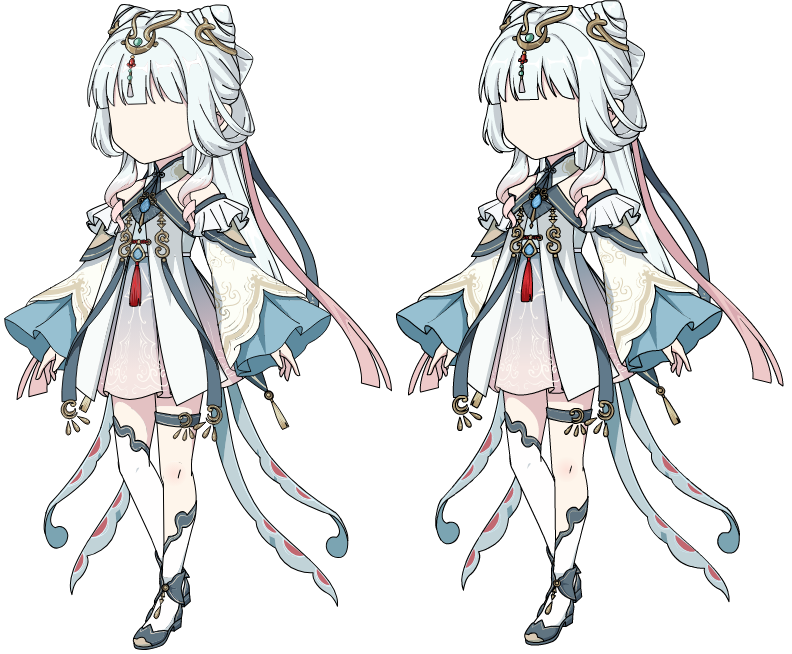
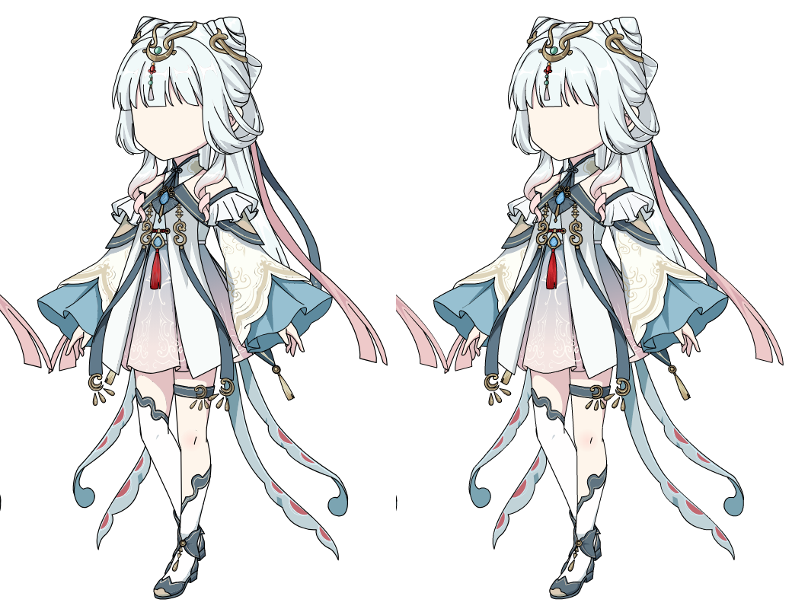
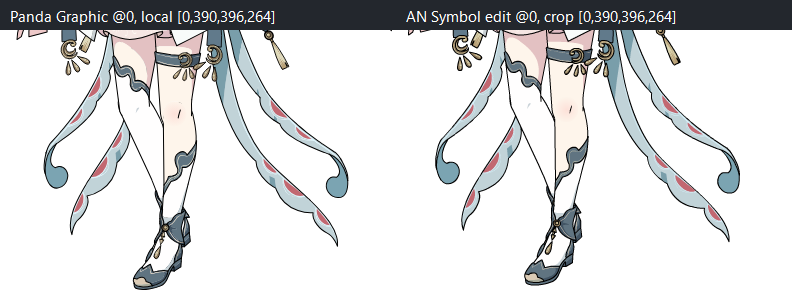
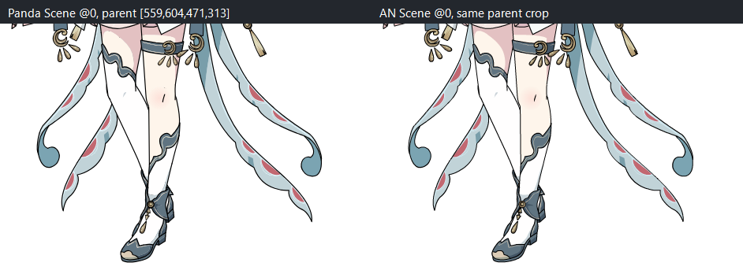

# Issue #770 R1 evidence — Qingling `元件 1@0`

## Repository evidence index

The package includes the underlying receipts, script, renders, and reviewed screenshots:

- Animate UI: [Scene open](animate/after-open.png), [Symbol edit](animate/after-jsfl.png), [save prompt](animate/close-prompt.png), [No selected](animate/close-prompt-focus.png), [Commands menu](animate/commands-menu.png), and [JSFL picker](animate/dialog-folder.png).
- Animate exports: [Scene frame 0](animate/scene-00.png) and [Symbol frame 0](animate/symbol-00.png).
- Panda renders and receipts: [symbol PNG](panda/symbol/repeat.png), [symbol SVG](panda/symbol/repeat.svg), [symbol receipt](panda/symbol/repeat-receipt.json), [Scene PNG](panda/scene/repeat.png), [Scene SVG](panda/scene/repeat.svg), and [Scene receipt](panda/scene/repeat-receipt.json).
- Matched comparisons: [local symbol](animate/symbol-local-side-by-side.png), [Scene instance](animate/scene-target-side-by-side.png), [local leg detail](animate/leg-local-pair.png), and [Scene leg detail](animate/leg-scene-pair.png).
- Capture provenance: [JSFL script](scripts/capture-r1-qingling.jsfl) and [Animate structural receipt](animate/capture.json).

## At-a-glance comparisons

Date: 2026-10-13. Scope: one exact FLA, the requested `重复项目文件夹/元件 1@0`, and its actual Scene instance. This is a local AN2023 behavior observation, not a claim about every Adobe build.

## Frozen identity

- Original: `D:\表情合集\新人物\青绫修仙女（四视角）.fla`, 3,758,039 bytes; SHA-256 before and after: `D0958D4432DECBF6C54566BA15A2F5E97BD88C82D75DCB2F84603E9B2273F0E4`.
- Disposable inspection copy: `input\qingling-source-copy.fla`; same byte length and SHA-256 before and after.
- Prior #746 parser receipt for that same exact source hash recorded in-memory recovery normalization only (no archive write): normalized archive SHA-256 `D0F940D6F7398C099D15DA1104BB8615FEB361D6E38D211F944AB072808ACAF4`.
- Local Animate: `WIN 23,0,0,407`; `Animate.exe` SHA-256 `0F869BD383E679611C6F85D887F72FE636B16403A5B98F79DF87F6F563ED3838`.

## Animate capture

JSFL: `scripts\capture-r1-qingling.jsfl`; Animate process/session PID `788`, active document `D:\PandaStage-Acceptance\REA-R1-770-20261013\input\qingling-source-copy.fla`; receipt: `animate\capture.json` (SHA-256 `70D37180C4CE10D15DE5328BD49B75EA2C5B1B2A32D7C1DD474027731ABFD3BD`). Receipt status `CAPTURED`; Scene 1 frame 0, 1920×1080, one layer; Graphic `重复项目文件夹/元件 1` frame 0, 30 frames, five layers.

Exact display-list addresses and properties:

- Scene instance: `scene:0/layer-0-frame-0/0` → `重复项目文件夹/元件 1`, Graphic frame 0; visible, depth 3, loop, firstFrame 0; matrix `a=d=1.1864013671875, b=c=0, tx=559.1, ty=141.8`.
- Nested leg-area Graphic instance: `graphic:重复项目文件夹/元件 1@0/layer-2-frame-0/0` → `重复项目文件夹/补间 5`, 762-frame Graphic; visible, depth 0, loop, firstFrame 0; matrix `a=d=1, b=c=0, tx=191.55, ty=391.2`.
- The directly evaluated child playhead is **UNKNOWN**; JSFL exposed firstFrame/loop and authored frame counts, not a resolved runtime child-frame value. Registration point is also **UNKNOWN** in this capture; the recorded property set did not expose a separate point. Layer indices, visibility and depth are recorded. No 762-frame playback sweep was performed.
- No save API was called. Animate displayed an unsaved `*` after entering Symbol edit; I chose “No” in the save prompt when closing. Original and copy hashes remained unchanged. JSFL's `doc.modified` getter returned null, so that flag is recorded as unavailable rather than false.

AN frame exports:

- `animate\scene-00.png`, 1920×1080, SHA-256 `9CECA148FCA8F5398F6D12611D29FD905CDBF7F8367E9EB3B64E5A39980D7D59`.
- `animate\symbol-00.png`, 1920×1080 stage export, SHA-256 `89FCF287113E673019987501D4D273E3D3337C1CB92D7CA5F29687DBC29C0B80`.
- `animate\after-jsfl.png` is the visible Animate Symbol-edit capture. The exported symbol content occupies the local top-left region; comparison crop was `[x=0,y=0,w=396,h=654]` with no resampling.

## Panda production capture

Current production parser/catalog/static-snapshot preview ran read-only on the same hash and frame 0. Both targets were discovered and rendered (symbol 444 ms; Scene 1,450 ms); no first blocker was reported. Both receipts record `projectMutation=NONE` and no commit API call.

- Symbol target ID `fla-render-target-b13a0be5089c89a01785e324f5e25a6919cc6e9f4404f46624adb53ab207fd41`, label `重复项目文件夹/元件 1`, selected frame 0; historical catalog candidate `C734-A30B9EBBABBEAFE95B257C7D` maps to Graphic owner `重复项目文件夹/元件 1`, frame 0. PNG 396×654 SHA-256 `2C24A46F1067E7A7EBF612004EB917F88252256EBF4D69C65331F48A721C1088`; SVG SHA-256 `85030284E94ED17EC0D67DF3569626A0573E7D2DF7E8DD56ECB24807EE904100`. Both hashes reproduce #746/#754.
- Scene target ID `fla-render-target-429e45fa685097106ad1b033fa4c3325a3df195196e79e0ddf6a4bf56971b6b3`, selected frame 0; historical candidate `C734-563C0D17702841C477A36B24` maps to Scene 1 frame 0. PNG 1920×1080 SHA-256 `7CDCDD02D2ABDBB8F5C341A4AD1A0F5E2DB76B0DA58C195B40C37E5F9E5676A6`, matching #754. Current SVG SHA-256 `362A9BB71FEDCD99E6453CA4B6278DD862D8F3A9C72CA44A221781DC1B127DEC`; #754 has no comparable prior SVG baseline.
- Current production receipts: `panda\symbol\repeat-receipt.json` and `panda\scene\repeat-receipt.json`. The current JSFL source-address chain above is from this exact opened FLA; the #754 candidate catalog record supplies the same root identity and frame.

## Matched-context comparison

- `animate\symbol-local-side-by-side.png` (SHA-256 `562F95EE58BA6076C9634C38FEF221EEC94C125D5098AF138CF5F4E9625F8833`): left is Panda's native 396×654 Graphic; right is the top-left 396×654 crop of Animate's 1920×1080 Symbol-edit export. The suspicious lower-leg asymmetry is visibly present in both. Rendering/framing pixels differ slightly; this is not an exact pixel-parity claim.
- `animate\scene-target-side-by-side.png` (SHA-256 `A67656572D949AA9F9BA654D3808C3F0880E88B8DD4BA905ED17F3ED3F3C2AF6`): left is Panda, right is Animate; both are the same `[x=510,y=120,w=520,h=800]` parent-stage crop. The same `元件 1` instance is visible with the same outer matrix. Local-to-parent mapping is `X=559.1+1.1864013671875*x`, `Y=141.8+1.1864013671875*y`; the target's local 396×654 viewport maps to approximately 470×776 parent pixels.
- `animate\leg-local-pair.png` (SHA-256 `BF4E4D55FD4DA759459311BC7ABD76ECAFCE0AA64B6A7976237C24849BD437CE`): annotated lower-limb detail; source crop `[x=0,y=390,w=396,h=264]` on each local Graphic.
- `animate\leg-scene-pair.png` (SHA-256 `43D56C99FC5376A82C97E4DF774DCD7455352CDBEF42B64A6D5797C56064EF2B`): same lower-limb area mapped through the Scene matrix; parent crop `[x=559,y=604,w=471,h=313]`, rounded to whole parent pixels. Both detail pairs show the same hem/leg/ankle arrangement.

The complete Scene images are not pixel-identical: Animate's rightmost figure differs visibly from the Panda Scene output. The JSFL Scene display list has an additional direct Shape at `scene:0/layer-0-frame-0/3` (depth 0; mirrored horizontal matrix `a=-0.835906982421875, d=0.835906982421875, tx=2794.05, ty=97.55`). Its causal relation to that full-scene difference was not independently isolated. This is outside the requested `元件 1` lower-limb target; `元件 4@0` was therefore not opened as a control.

## Hypotheses and disposition

- H1 `SOURCE_AUTHORED`: predicted the same leg arrangement in Animate Symbol-edit and Panda's same Graphic frame. **Observed.** The asymmetry exists in the local AN frame-0 output and the same Scene instance region; this describes the authored result, not design intent.
- H2 `CONTEXT_OR_CROP`: predicted an apparent mismatch caused by comparing a local Graphic with its transformed Scene instance. **Not supported as the leg-offset cause** after comparing local-to-local and the same parent-stage region with the recorded matrix.
- H3 `PANDA_SEMANTIC_DELTA`: predicted normal AN legs and offset Panda legs in the same root/frame. **Falsified for this target**; both show the same arrangement.

**R1 gate result: STOP / NO-GO for R2 on this sample; owner review pending. Principal classification: `R1_SOURCE_AUTHORED_NO_DELTA`** for `重复项目文件夹/元件 1@0` and its Scene instance. No first Panda/AN divergence was established for the requested leg target. This does not claim full Scene pixel parity or a new owner HUMAN VISUAL PASS; the separate full-scene Shape difference remains unverified.

**Next action:** stop for owner review. No #768 R2 question is proposed from this sample; the independent full-scene Shape observation needs a separate owner decision before expanding scope.

No production source, tests, CI jobs, or FLA bytes were changed. This repository directory archives the bounded research evidence; the original FLA, disposable FLA copy, and Animate executable are not included.