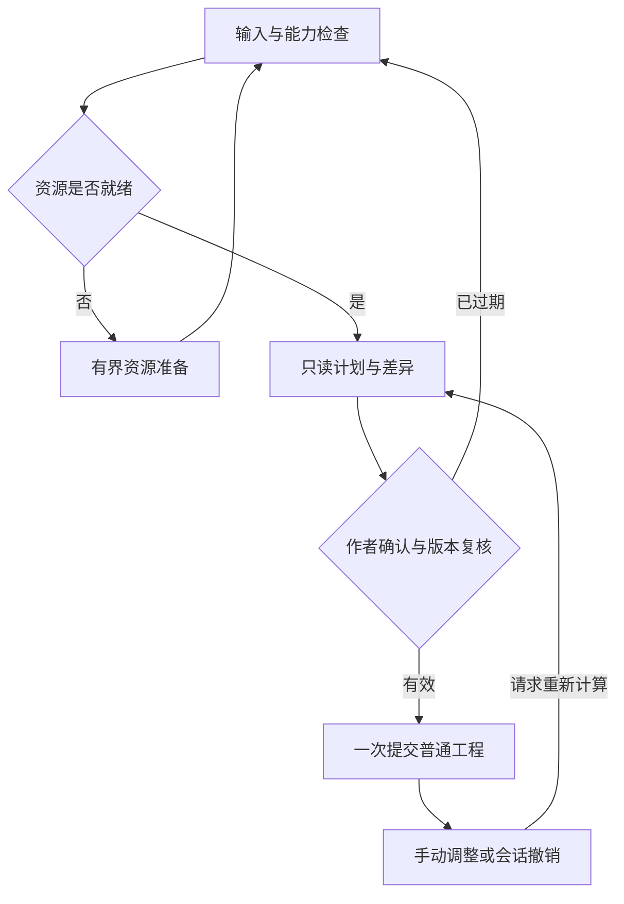

# Panda Stage：自动创作之外的自动化机会与落地方案

日期：2026-10-19。状态：研究建议；本 PR 仅新增文档，不授权后续实现。

## 1. 问题背景与核心结论

用户提供的《自动创作产品能力演进路线图 v0.1》已经规划了 V0 自动布景、V1 批量创作、V2 自动导演。本文继续回答：**除了第一次把故事生成出来，还有哪些重复劳动可以交给软件？**

最值得扩展的是四段工作：**准备可用资源、批量套用已确认规则、修改后的局部更新、交付前检查与重复输出。** 它们不必全部依赖 AI，也不必等完整人物 Rig 或任意 FLA 兼容才能产生价值。

建议把产品逐步发展成“有边界的制作助手”：作者确认人物、素材、风格和例外，软件完成可解释的机械操作，结果仍然是普通可编辑工程。初次生成只是其中一段；更长期的价值在于“改一句话不用重做半个片子”。

优先顺序建议：

1. 保持 #801 的 AC-01 首刀，证明已有素材可以安全生成一个镜头。
2. 首批新增机会优先选**资源清单与绑定复用、字幕风险巡检、确认后的批量规则应用**，分别验证，避免先造通用自动化平台。
3. 在声音和动作底座稳定后，增加**时间锚点、局部重排、手调内容保护**，解决返工成本。
4. 正式导出通过后，再增加批量导出与版本检查；自动生成、自动检查都不替代作者看听成片。

本报告延续 #801，不另立 V3/V4 总路线，不把“增加更多 AI 调用”当作自动化成熟度。

## 2. 依据、最新代码状态与报告关系

### 2.1 输入及核验基线

| 依据 | 本次核验 | 使用边界 |
| --- | --- | --- |
| 用户附件 `PandaStage_AutoCreation_Roadmap_v0.1_2026-10-17.md` | 已完整读取；SHA-256 `fe8c56f86b63dc0302e8fe4e4d3a8e9f35640d82c547b4321e4ac47f03304e37` | 保留其外部 AI 整理、内部确定性执行、一次提交与渐进验收原则 |
| [#801 自动创作总路线](https://github.com/Cognitive-Architect/panda-stage/issues/801) | AC-01～AC-09 仍登记为规划；首刀 AC-01 未派单 | 唯一自动创作派单总入口；本文机会编号不是新 Issue |
| main | `79b2b381cc1e60fcfa139919e7e32b3024f7d17a`，Schema v8 | 正式路径的代码事实 |
| [#665 A 线](https://github.com/Cognitive-Architect/panda-stage/pull/665) | `cad124d2500844ba2ec979e04a6d79ecad7f4628`；Draft/Open/Unmerged | 布局复用与混音属于候选实现，不能算 main 已交付 |
| [#791 B 线](https://github.com/Cognitive-Architect/panda-stage/pull/791) | 研究开始 `eecb35aa5c67f9085012c8e37a611ddca21ec1c7`；提交前已到 `fee6ba6b9761f3c81574337c9531864c21dc28e9`；仍 Draft/Open/Unmerged | 已核对新增缩略图临时文件名修复及对应两份测试差异；不将候选修复当作正式交付 |
| [人物结构报告 #802](https://github.com/Cognitive-Architect/panda-stage/pull/802) / [能力缺口报告 #805](https://github.com/Cognitive-Architect/panda-stage/pull/805) | 均 Open/Unmerged；分别固定到 `8e6462ff` / `20f2cfd9` | 前者回答结构如何扩展，后者回答缺什么，本文回答这些环节如何减少人工操作 |

最新 [#806 正式使用验收](https://github.com/Cognitive-Architect/panda-stage/issues/806)、[#807 路径实验](https://github.com/Cognitive-Architect/panda-stage/issues/807)、[#808 缩略图修复票](https://github.com/Cognitive-Architect/panda-stage/issues/808)还说明：图片已可入镜头、保存重开，不代表缩略图一定正常。提交前复核发现缩短临时文件名的修复已进入 #791；#808 最新回执为 `FIXED_REVIEW_PENDING / GUI_NOT_VERIFIED / OWNER_ACCEPTANCE_PENDING`，不再采用其页首旧的 NOT_STARTED 状态。不能把“缩略图失败”自动判断为源人物不可用，也不能因为缺缩略图就无限重试导入。本文只更新事实截点，不替该修复做独立 Review 或真人验收。

本轮阅读正式模型、服务、相关测试和工单，不运行产品、真实素材导入或 Windows GUI。下文“建议字段/接口/规则”均非现有 API；“可复用”表示有实现依据，不代表新工作流已通过集成验收。

### 2.2 已有自动化与尚缺的部分

| 已有基础 | 代码事实 | 本次真正增量 |
| --- | --- | --- |
| 项目与历史 | `updateProject` 校验 Project 并执行 ProjectCommand；无变化不写；导入路径会清空 History [E1] | 跨多个编辑动作的有界计划与统一提交；外部资源准备不能冒充可撤销编辑 |
| 资源处理 | 元数据检查、hash、缩略图服务；导入音频已有串行刷新队列，切项目停止 [E2] | 制作前的可用清单、确认后的语义绑定复用、失败分层，而非重做元数据队列 |
| 镜头/图层 | 创建、背景铺放、复制镜头及内部引用 remap [E3] | 参数化布景、模板角色槽、连续镜头布局建议 |
| 对白/字幕 | 批量粘贴和角色映射；新建批量对白是同时间点未排时项；字幕已有两行排版、超长截断警告和共享样式 [E4][E5] | 全片可读性检查、分段建议、草稿排时与局部样式应用 |
| 声音 | Shot-local BGM/SFX 编辑及多源预览；对白音频另由 DialogueService 管理 [E6] | 批量音频配对、跨镜头铺乐、明确 cue 驱动的音效安排 |
| 动作/运镜 | 8 个预设生成事件、Position 编辑、说话人自动聚焦 [E7][E8] | 动作组合规则、冲突预检、持久时间关联及作者可锁定的导演建议 |
| 角色布局 | #799 已在 #665 实现从已保存角色复制兼容布局；精确 Body 尺寸和 Head 存在性检查 [E9] | 后续可考虑批量候选/异常集中审阅，不能重新立一套 V0 布局模板系统 |
| FLA/导出 | 连续帧提交仍为 ImageAssets；正式导出缺口详见 #805，主线隐藏渲染器仍消费探针 [E10] | 支持范围内的候选整理；序列播放、正式导出完成后才编排对应自动任务 |

## 3. 自动化程度：什么让机器直接做，什么留给人

| 级别 | 例子 | 产品行为 |
| --- | --- | --- |
| 自动计算 | 检查引用、估算字幕排版、生成资源清单、计算受影响对象 | 可在用户启动任务后直接运行；只读结果不制造工程修改 |
| 批量执行已确认规则 | 将选定样式应用到选定对白、按明确 cue 放指定音效 | 一次预览和确认整批结果；只有异常需要额外处理 |
| 自动推荐 | 从相似名称挑素材、按对白推荐反应镜头、建议表情 | 展示候选、理由与受影响范围，不默默定夺 |
| 保留人工判断 | 选择笑点、判断姿势好不好看、素材是否能发布、最终成片是否满意 | 工具提供对照和问题定位，作者作判断 |

用户已经确认的同一批规则不应逐条重复弹窗。例如 20 个镜头套同一字幕规则，只确认作用范围和例外；替换素材身份、覆盖手调内容、联网计费属于不同决策，另有明确选择。

## 4. 全流程自动化机会地图

AU 编号仅用于本文检索，不是已授权的实施票。优先级按规则确定性、重复频率和错误恢复成本排序，尚无实测收益或工期估算。

| 编号 | 可以自动做什么 | 最小输入 → 可编辑结果 | 与原路线图的增量 | 时机 |
| --- | --- | --- | --- | --- |
| AU-01 | 制作资源清单与外部整理提示词 | 当前项目可用资源 → 精简目录、支持动作、格式示例 | 给外部 AI 明确可用范围，减少它编造资源；承接 AC-02 | 首批 |
| AU-02 | 一次确认、整批复用资源绑定 | 源标签/别名 + 用户确认 → 本批稳定 ID 映射 | 同一个“张三/花园”不逐行重复处理 | 首批 |
| AU-03 | FLA 候选分组与有限批量准备 | 用户选定源文件/目标/帧范围 → 审阅队列与入库计划 | 省掉逐项找候选、反复打开；不自动猜 FLA 语义 | 底座可用后 |
| AU-04 | 批量套兼容角色布局 | 已保存来源 + 明确目标列表 → 逐目标组装草稿 | 扩展 #799 的重复应用，保留素材身份和人工微调 | #799 验收后 |
| AU-05 | 场景配方与连续镜头布置 | 背景、角色槽、左右站位、继承策略 → 独立镜头 | 不只复制 Shot，还能换演员、保视线方向、保已确认布局 | #593 / AC-04 后 |
| AU-06 | 字幕巡检、分段建议与统一样式 | 原对白 + 样式 + 时间 → 风险清单/建议块 | 防止长句被显示截断，减少重复改样式与时长 | 只读巡检可先做 |
| AU-07 | 配音批量匹配与受控重做 | dialogueId 清单 + 音频/生成回执 → 正确绑定及失效提示 | 修一句台词只重做受影响声音，而非整批推倒 | AC-07 |
| AU-08 | BGM 铺放与 cue 音效 | 选定音乐范围、音效 ID 和触发点 → 普通 AudioClips | 跨镜头源 offset 连续；规则化音效落点 | 基础编辑先行，输出受导出门禁约束 |
| AU-09 | 时间锚点与局部重排 | 句尾/动作点 + offset → 时间更新差异 | 音频变长后机械计算哪些事件随动，保护手调 | V2 增强 |
| AU-10 | 表演配方与口型草稿 | 已支持表情/动作 + 明确 cue；后续音频分析 → 可编辑表演 | “说完停一下再抖”一次编排；先静音闭嘴，再研究多嘴型 | AC-08 / 动作与 Cue 底座 |
| AU-11 | 运镜建议与构图检查 | 说话实例、导演规则、手动锁定 → 镜头建议 | 补充反应镜头、全景回退与频率约束 | AC-09 / 持久运镜合同 |
| AU-12 | 修改影响分析与选择性更新 | 本次输入变化 + 旧生成记录 → 局部替换计划 | 作者改过的内容保留；仅更新明确归属的字段 | V2 后段，先做只读影响分析 |
| AU-13 | 制作检查与局部修复 | 当前工程及目标能力 → 定位、预览、可选修复 | 自动发现漏对白/越界/未支持动作等技术问题 | 首批只读；随能力扩展 |
| AU-14 | 导出队列、版本核对与依赖打包 | 已确认快照、规格、输出位置 → 可追溯交付物 | 减少重复设置，核对改稿版本与资源完整性 | 正式 Export / 打包底座通过后 |

## 5. 先把“备料”自动化：AU-01～AU-04

### 5.1 输出外部 AI 真正能使用的资源清单

用户选当前工程中的一组角色和背景，点击“复制整理提示词”。输出应带：格式版本、允许的指令、可用名称及短引用、必要的表情/动作选项、尚不支持的能力和一个最小例子。只包含本任务相关资源；不要把几千项 FLA 内部元件和本地路径全部塞给模型。

建议草稿映射为 `shortRef → stableId + assetHash/definitionFingerprint`。短引用只在本次清单内有效；返回结果仍由本地校验，模型输出一个 ID 也不能绕过资源类型和存在性检查。用户复制是明确的数据分享动作；不自动上传工程、音频或全部台词。

**新增价值：** 外部 AI 在已知“菜单”里整理内容，用户不用先改名几十次，再回软件逐条处理“找不到花园”。目前 Asset 分类把非角色图片归背景的规则不代表图像内容识别，清单中的用途应由作者确认。[E11]

### 5.2 将资源歧义集中处理

先对本批唯一标签去重；展示每种歧义一次。精确唯一匹配可进入待执行计划，相似名只供选择。确认后同一标签在本批复用同一个 ID；目标被删、替换或定义变化后失效。跨会话别名库是后续扩展，不应为 AC-01 提前加数据库。

同名资源不等于同一资源，hash 相同也不代表用途相同。精确像素去重只节省存储；重复帧仍可能表示作者刻意停顿，不能自动删掉时间项。

### 5.3 自动准备可用候选，停止重复失败

对用户明确选择的 FLA 目标与有限帧范围，复用既有工作台生成审阅队列；缓存键至少关联源 hash、目标/帧、渲染规则版本。可以自动分组“同源/同尺寸/完全相同输出”，不能凭 `元件 1` 命名自动标成头或正视图。

显示三个独立事实：**原图/源目标可用、缩略图可用、动画播放能力可用**。元数据刷新可能写正式项目，它与只读检查应分开执行。#808 的深路径修复仍按其验收与集成流程推进，自动化只可有限重试并定位错误，不能删原图、绕过门禁或悄悄移动用户项目。[E2][E10]

### 5.4 角色组装自动化沿用 #799

现有候选已有“选来源 → 预览 → 微调 → Apply”，无需重复建设。以后扩为多目标时，先列兼容目标和异常：同尺寸/同结构接受候选，体型不兼容保持手动。逐目标微调后对明确选中的有效集合预检，再整体应用；不能将失败目标静默跳过并报全成功。

V1 同源 FLA 可编辑装配、通用多部件应继续挂 [#796](https://github.com/Cognitive-Architect/panda-stage/issues/796) 与 #802。任意 PNG 的自动拆件、猜关节不是批量布局的隐含前置；静态人物完整 PNG 也不自动提供这些信息。

## 6. 批量制作：AU-05～AU-08

### 6.1 从“镜头模板”到“场景配方”

镜头模板保存一次布景；配方进一步描述“谁填哪个槽位”。第一版只在项目内支持：背景 ID、左/右角色槽、默认位置/朝向、允许的动作及明确替换关系，实例化仍生成独立 Shot/Layer。换演员时其表情 ID 不能从原角色直接照抄，必须重新映射或阻断相应事件。

连续镜头可用上一镜头**求值后的末态**建议下一镜头站位，但仅用于用户确认的同场景连续镜头。跳切、换地点和故意反向构图不自动纠正；多实例同角色必须明确映射。继承的是选定字段的快照，不是永久跟随链。静态 `layer.x/y` 不一定是动作后的终点，需复用正式求值器。[E3][E7]

### 6.2 字幕巡检比“自动断句万能化”更先落地

现有 `layoutSubtitleText` 已自动折行；超过两行会截断并警告。因此第一刀不是再写一个换行算法，而是遍历全片对白，复用该结果集中指出超长内容，并提供定位。[E5]

随后才建议按标点拆分、调整时长或使用另一已确认样式。规则必须保留原文，不能悄悄摘要台词。**有配音的对白不能直接一拆二并复制原 audioClipId**：必须先定义字幕片段与音频归属，否则可能串时序或重复音频。第一版可只自动处理无音频草稿，已绑定音频的行只给建议。

字幕样式是共享对象，修改一个 style 会影响所有引用它的对白。对“只改这三句”应先明确是否复用、创建专用样式或重新绑定，不能改共享样式后误称局部修改。字体大小不可无限缩小来躲避截断；安全区结果也不等于真人阅读感受已通过。

### 6.3 配音匹配、失效与重做

优先接受已导入音频的显式清单：`dialogueId → assetId/hash`；文件名可提供候选，台词相同也不自动认成同一说话实例。未来接外部合成时，任务指纹应覆盖文字、声音身份、语速/音调、服务与规则版本，不能只按文本去重。

改字、换声音或配置变化时，将原绑定标记为待确认/失效建议；不要直接删除仍在其他地方被使用的音频。新文件就绪后才生成时间更新计划。失败重试复用成功结果，但不能重复计费、重复入库；现有 VoiceProfile 不等于已接 TTS。[E4][E6]

### 6.4 自动铺乐与音效落点

选择已可用的一首 BGM 和明确镜头范围，在每个 Shot 生成普通 bgm clip；通过累计 source offset 保持歌的时间连续，源音频不够长则提示缩短/换曲，循环必须显式开启并另验边界。现有 `AudioClipService.create` 默认 offset=0 且受 Shot 尾裁剪，简单循环调用它会让每幕从头响，不能把这种接线当作功能完成。[E6]

音效先按明确 cue，例如“D03 句尾后 200ms 播放已选音效”，不要扫描对白中的“爆炸”二字就自行放爆炸声。BGM ducking、自动响度与音量包络需要共享的分析/求值合同；固定 clip gain 不能冒充已有包络。预览自动铺放可先独立验收，正式输出仍依赖 #562 与 A04 的实际交付状态。

## 7. 返工自动化是长期重点：AU-09～AU-12

### 7.1 先建立时间关系，再自动重排

建议作者能表达“跟着这句结束”“这个音效锁在绝对时间”“该动作整体保持时长”，而不只是给每个东西一个毫秒数。最小 TimeAnchor 草案：

| 字段 | 用途 |
| --- | --- |
| `scopeShotId` | 首版只在一镜头内传播，不隐式全片 ripple |
| `anchorKind` | absolute / dialogue-start / dialogue-end / event-end |
| `anchorId`、`offsetMs` | 依赖对象及相对偏移；absolute 不引用其它对象 |
| `durationPolicy` | keep-duration / fit-explicit-range；不默认拉伸音频或动作 |
| `editPolicy` | 允许本次重算 / 保持当前值 / 需作者选择 |

这些是规划字段，当前事件模型并未保存上述关系。先将依赖放入生成计划；需要重开后继续重排时，再通过专门 Schema/迁移保存必要来源，而不是塞进现有严格模型的未知字段。

例如 D02 从 2 秒变 3 秒：跟随 D02 句尾的 SFX 延后 1 秒；锁在绝对时间的爆炸保持原位；若两者相撞，报告冲突，不自动挪开所有内容。若需延长镜头，先展示影响；缩短镜头不能裁掉现有内容，现有 ShotService 已拒绝这种修改。[E3]

首刀仅做“一个镜头、一句对白、一个跟随音效”的只读差异；通过后再提交。循环依赖、被删锚点、负时间、越界和非正时长均拒绝。毫秒与项目帧网格的取整规则明确记录，音频源时间与画面采样时间不能混为一谈。

### 7.2 表演配方用已有能力，且保持稀疏

可先支持“句首切已选表情 → 句尾停 300ms → 抖动 400ms”这样的显式配方，落到已支持事件；不是根据每句台词自动发明一套表演。作者可选整段的频率与幅度，随机变体若加入需固定 seed 和规则版本，保存后、seek、导出保持一致。

新事实值得注意：现有 `createPresetEvents` 的同属性重叠检查会 `console.warn`，不是完整的阻断/解决流程；正式运动求值又已有 Position/Shake 的专门处理。因此自动化不能只依赖一条 warning，也不能粗暴禁止所有 move+shake；需按当前支持的叠加语义做通道级预检，未知组合要求选择。[E7]

角色没有相应表情/动作、旋转动画合同未实现、栅格序列未进入镜头运行时，就不能宣布自动表演成功。平移不能偷偷当走路替代；用户主动选择静态降级后，计划和结果应仍显示降级。

**口型也有自动化空间，但需另一个有界切片。** 当前 Simple Mouth 是相对音频起点的 320ms 开闭周期，没有识别语音内部静音。[E13] 可先对用户指定音频分析静音候选，生成可编辑的“暂停张嘴”区间；阈值、最短区间和边界缓冲有版本记录，用户能试听修正。低音量说话、呼吸和噪声会误判，不能把能量阈值叫作音素识别。MouthCue 的持久化与统一求值尚需建设，不能偷偷用修改对白时间来模拟闭嘴。

再往后才考虑多嘴型、音素对齐，以及固定 seed 的稀疏眨眼/待机动作。前提是人物真的有相应状态和可用通道，手工口型优先；分析按源音频时间保存，再根据 clip offset/trim 映射到镜头时间，裁剪、替换音频后必须重新校验。自动生成的是可修正草稿，不能只在实时播放器里临时算一遍而让导出不同步。

### 7.3 运镜推荐复用现有自动聚焦

现有说话人聚焦已根据对白计算，不需要再写第二个自动摄像机。可增加的机会是：作者显式标记的听者反应、全景停留、最短保持时长和构图风险建议；同角色多实例时明确说话对象，不按数组顺序随便选人。

先给建议片段并允许保留原镜头；持久化、手动覆盖和导出模式一致性仍需补合同。既有 autoCameraEnabled 是会话状态，不是已可保存的导演轨。[E8]

### 7.4 选择性更新：生成内容不能压过手调

V0/V1 继续遵守原路线图的新增批次模式，不做双向同步。选择性更新属于后续能力，至少需记录：源条目稳定 ID、生成批次、规则版本、目标对象/字段、生成基准值或指纹、依赖列表。**不要用“当前值恰好等于生成值”作为用户从未编辑过的唯一证据**；作者明确“保持此项”的意图优先。

| 新输入到来时 | 建议处理 |
| --- | --- |
| 目标与来源均未变 | 不写入，不新增 History |
| 系统生成字段未被作者接管 | 展示可更新差异；一次确认后更新选中范围 |
| 作者改了该字段或明确保持 | 默认保留，列为需选择的冲突 |
| 对象被作者删除、换了身份 | 不悄悄复活，不按同名对象接管；重新绑定或新增 |
| 来源条目消失 | 建议移除对应生成内容，仍需检查人工修改和其它引用 |
| 工程在预览后变化 | 原计划失效，重新计算；不覆盖新状态 |

“保持自动化字段”与现有 Layer 的编辑锁不是同一种语义，应独立设计。来源记录是可编辑内容的辅助信息，不是第二套工程；丢失记录时仍能普通编辑，但暂停选择性自动覆盖。History 仍只在会话中存在，不拿生成记录伪装为跨重启 Undo。

## 8. 自动检查与交付：AU-13/AU-14

### 8.1 检查先于自动修复

复用引用扫描器、正式 Schema、资源状态、字幕排版、事件验证和目标支持清单，输出 `问题 → 镜头/对象 → 原因 → 下一步`。区分硬错误与建议：无效引用/缺资源会阻断对应操作；长句、留白、疑似越界构图不应直接删除内容。[E12]

新检查应关注生产结果：哪些非空源条目没有生成、哪些字幕显示截断、哪些配音对应旧文本、哪些动作超出时长、哪些内容预览支持但导出尚不支持。现有 schema 能验证关系，不保证人物没有被前景挡住、声音实际听起来合适；复杂视觉判断只报候选问题。

局部修复可从“调整选定无音频草稿时间”“将选定对白绑定到已确认样式”开始。缺失资源不得自动换成近似名字图片；不自动清理原素材、改路径或删缓存来求通过。用户对一类已确认规则可批量接受，无需为每个简单项多点一次。

### 8.2 批量输出要排在正式导出之后

未来队列每项冻结 project snapshot、支持版本、输出规格、目标路径及资源指纹；重试只重试失败项，默认不覆盖成功作品。输出前检查快照和资源可取得，完成后验证媒体流、时长、非空文件与相应产物身份，不能把 FFmpeg exit 0 当作作品内容正确的全部证据。

缓存完整成片或镜头需要确定性依赖键，覆盖素材、字体、渲染规则、字幕、音频、摄像机和输出规格。第一版若不能证明缓存正确，就完整重导选定范围；不提前实现复杂增量编码。多画幅、透明输出、跨项目打包必须先有对应底座，当前固定 1920×1080/24fps 不能因批处理而变成任意格式支持。

自动生成审阅缩略图、变更镜头列表和资源缺失清单可以降低检查成本；不做无人确认的外部发布，不自动上传整份工程。这里讨论软件功能规划，不创建定时任务或后台自动发布作业。

## 9. 共同实现边界：从小入口长出能力，不先造平台

### 9.1 两类计划分开，复用一个正式工程所有者

**编辑计划**只操作当前已就绪资源，通过现有领域服务得到新 Project，最后一次 `updateProject` 提交。不要循环调用会立即写 store 的 UI 操作而形成半批结果。中间服务的校验顺序也要合法，例如先扩时再放入新内容；最终仍必须通过完整校验。

**资源准备任务**包含导入、解码、渲染或未来合成，走 Main/Preload/ProjectOperationCoordinator。现有导入会清空历史，因此“导入音频＋整批编排一键撤销”尚无现成保证。首版可先明确完成资源准备，再基于新 revision 生成编辑计划；只承诺撤销编排，不承诺撤销资源文件或外部费用。需要更强原子性时单独设计事务，而不是用一个按钮掩盖区别。[E1][E2]

建议逻辑边界如下，名称仅为设计示意：

```ts
buildPlan(snapshot, request, capabilities): AutomationPlan
validatePlan(currentSnapshot, plan): Ready | Stale | Blocked
applyPlan(currentSnapshot, confirmedPlan): ProjectChangeResult
```

| 计划信息 | 责任 |
| --- | --- |
| `planVersion / operationId / ruleVersion` | 解析与规则可追踪；同一次确认重复触发不重复创建 |
| `projectId / projectInstanceId / baseRevision` | 对应一个打开会话和正式版本；只比 projectId 不够 |
| `sourceEntryIds / inputFingerprint` | 输入行改序或同名时仍能区分；不直接拿显示名称当永久身份 |
| `resourceBindings / resourceFingerprints` | ID、类型、可用性、实际使用字段/文件 hash 复核 |
| `operations / affectedFields / diff` | 白名单操作、改动范围、预览；不接受任意代码或自由文件路径 |
| `issues / explicitDecisions` | 未支持、歧义、覆盖、降级分别列明；阻塞未解决不提交 |
| `timeDependencies / generationOrigin` | 仅在需要局部更新时引入，按能力分阶段持久化 |

V0 只需一个小的领域协调入口和必要校验；第二个真实批量场景证明重复后，再抽共用组件。不要为这张报告先建设插件系统、节点编辑器、任意脚本语言、全局任务数据库或另一套 Project store。

### 9.2 具体生命周期



图中“请求重新计算”需读取最新正式快照重新构建计划，不复用旧 diff。资源准备失败停在可解释的错误状态，不自动无限循环。异步结果以任务身份和快照归属校验，迟到结果不得写回已关闭/切换的工程。首版防重覆盖当前会话的 operationId；跨重启恢复任务须有额外持久化合同，不提前承诺。

## 10. 可直接用于后续拆票的四个候选切片

以下并非同时开工指令。自动创作主线仍首先执行 #801 AC-01；独立辅助功能如被选中，需要各自明确范围，不把它们全部塞进 AC-01。

| 候选 | 单刀交付 | 样本与反例 | 验收标准 |
| --- | --- | --- | --- |
| F-A 资源清单/提示词 | 从当前项目选择 1 背景、2 角色，生成有限目录与模板；只读 | 缺素材、同名、未就绪、复制后删除资源 | 不改 revision/History；回传内容必须重新校验，失效资源不可执行 |
| F-B 字幕巡检 | 汇总 12 条对白的截断/未排时信息并定位，复用现有排版函数 | 普通短句、超两行长句、已有配音、共享样式 | 正文不变；问题与当前渲染一致；本刀不自动拆配音、不自称真人可读性 PASS |
| F-C 已有音频批量绑定 | 明确 3 个 dialogueId 与 3 个已就绪 audio asset，预览并一次应用 | 两条台词同文、时长不足、角色错误、重复点击、过期计划 | 绑定不串、源 offset 有效、失败零编排写入、一次撤销；不包含新文件导入 |
| F-D 一句改时的影响分析 | 一镜头内展示句尾音效随动、绝对时间动作保持及可能冲突 | 延长/缩短、删锚点、循环依赖、作者锁定 | 初版只读；后续写入须另证明整批历史与保存；不扩全片重排 |

F-A 对应 AC-02 的资源输入辅助，F-C/F-D 供 AC-07～AC-09 细化；F-B 是现有手动创作也能使用的独立收益。#593 模板、#799 布局复用、#695 动作和 #759 序列路线继续各自承接，不重复开功能总票。

## 11. 风险、测试与停止扩展的条件

### ⚠️ 三个最容易把省事变成返工的坑

1. **自动化覆盖人工修改。** 必须能查看字段差异、保持手调、取消更新；出现一次未确认覆盖就先修恢复路径，不扩大批量。
2. **时间或资源身份错配。** 同名人物、同文台词、重复帧和多个说话实例都不能靠名称/数组位置猜；语音变化引起的事件移动要明确依赖。
3. **撤销假象。** 工程 Undo、磁盘资源回滚、外部合成费用是三件事；必须分别说明，不能在失败后留下半批对象却显示取消成功。

其它工程风险以任务预算处理：解析/解码有上限、取消后释放资源、失败有限重试、切项目拒绝迟到结果。提示词或导入文件中的文本只作为数据，不具有执行工具、访问路径或绕过校验的权限。

后续实施测试应覆盖输出行为而非内部函数调用次数：

| 场景 | 必须能证明 |
| --- | --- |
| 同一输入、同一基线重复构建计划 | 语义结果稳定；新 ID 可一次分配冻结，不因为打开预览就改变工程 |
| 确认后双击/重试 | 同一操作不会创建两批；作者明确新建批次仍允许 |
| 第三项失败、计划过期、切换工程 | 编辑计划零部分提交；外部准备结果单独记账且不写错项目 |
| 撤销/重做、保存重开 | 普通内容完整，当前会话一次撤销；跨重启历史不作承诺 |
| 手动修改后重新计算 | 差异和保护意图保留，不静默覆盖或复活对象 |
| 音画编排与导出 | 相同时间点结果一致；正式输出能力未通过前只验编排草稿 |

本轮只写文档，不执行上述产品测试。未来按仓库最小适用验证矩阵运行，真实 Windows/看听验收与自动测试分别留证，不因“自动化”扩大为无限全仓验证。

## 12. 如何衡量确实省人力

继续使用原路线图的净省时口径：手工耗时减去自动流程总耗时，包含资源标注、外部整理、等待、检查和返修。记录三种阶段：首次设置、同模板再次制作、改稿；第一次很快但改稿昂贵的方案不能只报第一次成绩。

建议记录：每种独有资源需确认次数、批量例外率、生成后被手改的比例、一次改稿涉及的对象数、人工修复分钟数、失败恢复时间与技术漏检数。无业务埋点时可先用同一作者、同一素材、同一完成标准的本地操作记录；交换手工/自动顺序或重复测量以降低熟练度偏差。

#801 的 V1“至少减少 50%”是其固定故事的待测目标，不外推到每个新增能力。本报告不声称已实测省时，也不承诺每个操作都要自动化；若检查和返修超过手工，先减少规则种类并改进例外处理。

## 13. 证据索引与文档验证

代码链接固定 SHA；工单为动态入口，实际实施前重读。只证明可复用基础与当前边界，不证明本文新增设计已实现。

- [E1 EditorProjectStore](https://github.com/Cognitive-Architect/panda-stage/blob/79b2b381cc1e60fcfa139919e7e32b3024f7d17a/src/renderer/stores/EditorProjectStore.ts)；[ProjectCommand](https://github.com/Cognitive-Architect/panda-stage/blob/79b2b381cc1e60fcfa139919e7e32b3024f7d17a/src/history/commands/ProjectCommand.ts)；[会话身份/版本测试](https://github.com/Cognitive-Architect/panda-stage/blob/79b2b381cc1e60fcfa139919e7e32b3024f7d17a/tests/unit/editor-project-store.test.ts)。
- [E2 AssetMetadataService](https://github.com/Cognitive-Architect/panda-stage/blob/79b2b381cc1e60fcfa139919e7e32b3024f7d17a/src/main/services/AssetMetadataService.ts)；[串行元数据队列](https://github.com/Cognitive-Architect/panda-stage/blob/79b2b381cc1e60fcfa139919e7e32b3024f7d17a/src/renderer/features/assets/assetMetadataQueue.ts)；[队列测试](https://github.com/Cognitive-Architect/panda-stage/blob/79b2b381cc1e60fcfa139919e7e32b3024f7d17a/tests/unit/asset-metadata-queue.test.ts)。
- [E3 ShotService](https://github.com/Cognitive-Architect/panda-stage/blob/79b2b381cc1e60fcfa139919e7e32b3024f7d17a/src/domain/services/ShotService.ts)；[LayerService](https://github.com/Cognitive-Architect/panda-stage/blob/79b2b381cc1e60fcfa139919e7e32b3024f7d17a/src/domain/services/LayerService.ts)；[复制与缩时测试](https://github.com/Cognitive-Architect/panda-stage/blob/79b2b381cc1e60fcfa139919e7e32b3024f7d17a/tests/unit/shot-service.test.ts)。
- [E4 对白批量解析](https://github.com/Cognitive-Architect/panda-stage/blob/79b2b381cc1e60fcfa139919e7e32b3024f7d17a/src/renderer/features/dialogue/parseDialoguePaste.ts)；[DialogueService](https://github.com/Cognitive-Architect/panda-stage/blob/79b2b381cc1e60fcfa139919e7e32b3024f7d17a/src/domain/services/DialogueService.ts)。
- [E5 字幕排版](https://github.com/Cognitive-Architect/panda-stage/blob/79b2b381cc1e60fcfa139919e7e32b3024f7d17a/src/shared/preview/subtitle-layout.ts)；[排版测试](https://github.com/Cognitive-Architect/panda-stage/blob/79b2b381cc1e60fcfa139919e7e32b3024f7d17a/tests/unit/subtitle-layout.test.ts)；[共享样式服务](https://github.com/Cognitive-Architect/panda-stage/blob/79b2b381cc1e60fcfa139919e7e32b3024f7d17a/src/domain/services/SubtitleStyleService.ts)。
- [E6 AudioClipService](https://github.com/Cognitive-Architect/panda-stage/blob/79b2b381cc1e60fcfa139919e7e32b3024f7d17a/src/domain/services/AudioClipService.ts)；[音频合同](https://github.com/Cognitive-Architect/panda-stage/blob/79b2b381cc1e60fcfa139919e7e32b3024f7d17a/src/domain/audio-contract.ts)；[多源预览](https://github.com/Cognitive-Architect/panda-stage/blob/79b2b381cc1e60fcfa139919e7e32b3024f7d17a/src/renderer/shell/productPreviewAudio.ts)。
- [E7 动作生成与重叠提示](https://github.com/Cognitive-Architect/panda-stage/blob/79b2b381cc1e60fcfa139919e7e32b3024f7d17a/src/domain/actions/createPresetEvents.ts)；[正式求值器](https://github.com/Cognitive-Architect/panda-stage/blob/79b2b381cc1e60fcfa139919e7e32b3024f7d17a/src/domain/evaluate-shot-at-time.ts)；[Position chain](https://github.com/Cognitive-Architect/panda-stage/blob/79b2b381cc1e60fcfa139919e7e32b3024f7d17a/src/domain/position-chain.ts)。
- [E8 自动聚焦](https://github.com/Cognitive-Architect/panda-stage/blob/79b2b381cc1e60fcfa139919e7e32b3024f7d17a/src/domain/resolve-speaker-focus-camera.ts)；[会话设置](https://github.com/Cognitive-Architect/panda-stage/blob/79b2b381cc1e60fcfa139919e7e32b3024f7d17a/src/renderer/shell/EditorShell.tsx)。
- [E9 #665 布局复用候选](https://github.com/Cognitive-Architect/panda-stage/blob/cad124d2500844ba2ec979e04a6d79ecad7f4628/src/renderer/features/characters/characterLayoutReuse.ts)；[#799 实施与验收](https://github.com/Cognitive-Architect/panda-stage/issues/799)。
- [E10 连续帧提交](https://github.com/Cognitive-Architect/panda-stage/blob/79b2b381cc1e60fcfa139919e7e32b3024f7d17a/src/main/services/FlaFrameSequenceCommitService.ts)；[隐藏导出渲染器](https://github.com/Cognitive-Architect/panda-stage/blob/79b2b381cc1e60fcfa139919e7e32b3024f7d17a/src/export-renderer/ExportRendererApp.tsx)；[#562 正式导出](https://github.com/Cognitive-Architect/panda-stage/issues/562)；[#759 原动画产品化](https://github.com/Cognitive-Architect/panda-stage/issues/759)。
- [E11 资源分类](https://github.com/Cognitive-Architect/panda-stage/blob/79b2b381cc1e60fcfa139919e7e32b3024f7d17a/src/renderer/stores/assetLibrarySelectors.ts)；[Asset 模型](https://github.com/Cognitive-Architect/panda-stage/blob/79b2b381cc1e60fcfa139919e7e32b3024f7d17a/src/domain/models/asset.ts)。
- [E12 引用扫描器](https://github.com/Cognitive-Architect/panda-stage/blob/79b2b381cc1e60fcfa139919e7e32b3024f7d17a/src/domain/validators/referenceScanner.ts)；[事件应用校验](https://github.com/Cognitive-Architect/panda-stage/blob/79b2b381cc1e60fcfa139919e7e32b3024f7d17a/src/domain/validators/timelineEventValidator.ts)。
- [E13 当前简单口型](https://github.com/Cognitive-Architect/panda-stage/blob/79b2b381cc1e60fcfa139919e7e32b3024f7d17a/src/domain/selectors/temporalRender.ts)。
- 规划归口：[#685 字幕输入](https://github.com/Cognitive-Architect/panda-stage/issues/685)、[#593 预制镜头](https://github.com/Cognitive-Architect/panda-stage/issues/593)、[#695 Action/Pose](https://github.com/Cognitive-Architect/panda-stage/issues/695)、[#635 多轨音频](https://github.com/Cognitive-Architect/panda-stage/issues/635)。

本 PR 仅新增本报告；验证 Markdown 差异空白、代码链接目标、引用编号、附件 hash 与提交前基线。未执行产品测试、真实导出或真人验收，未手动触发 Full CI；后续代码工作遵循 [AGENTS.md](../../AGENTS.md) 的最小适用验证矩阵。原路线图、前两份报告、已有 Issue 与 A/B 实施分支均不由本 PR 修改。
