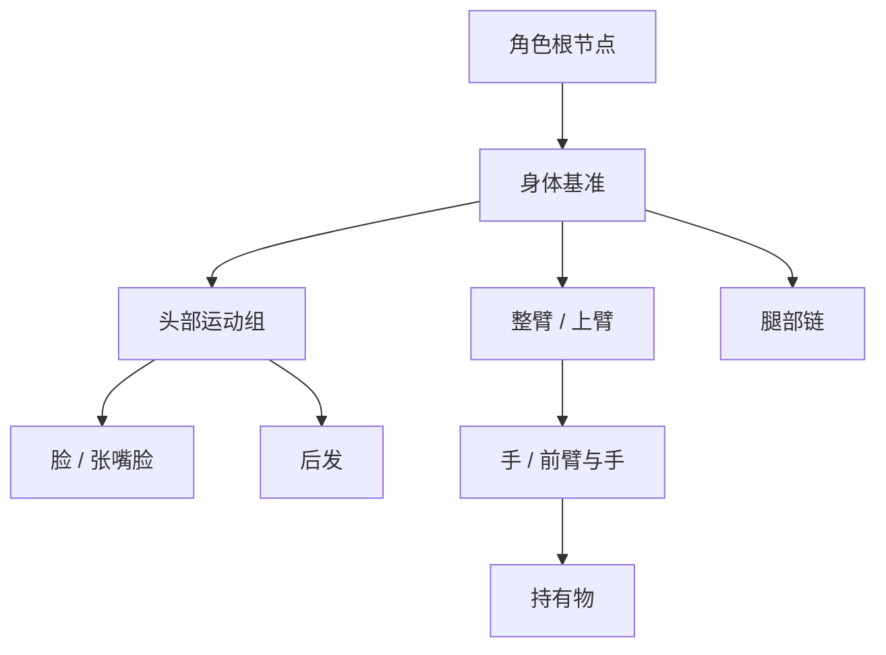

# Panda Stage 人物结构演进研究报告

> 版本：v0.1｜日期：2026-10-19（Asia/Shanghai）
>
> 状态：**设计建议，供评审和后续派单；本 PR 仅新增文档。**
>
> 目标：从现有「身体 + 头 + 脸/张嘴脸」平滑扩展到手臂、手、腿及配饰，让普通创作者能复用角色、切换姿势和套用动作。
>
> 本次用户授权包括代码调查、方案设计和文档 PR；不包括实现多部件、修改现有工单状态、合并 #665 或启动全部路线。

## 1. 问题背景 / 目标

当前人物组装已经让创作者分别选择身体、头与表情，但继续增加胳膊、腿、手时，问题不只是多放几张素材卡：还必须知道部件连接在哪里、跟谁运动、如何遮挡、替换状态后是否仍然对齐，以及镜头中的动作是否会误改角色本体。

**建议方向：保留简单角色，逐步增加可选部件；先跑通一条手臂和可换手势，再推广多肢体及动作复用。** 不以完整骨骼、IK、任意 FLA 自动拆人作为第一阶段前置条件。

最终希望实现的创作链路：选角色 → 需要时组装部件 → 选手势/姿势 → 放到镜头 → 套用短动作 → 对配音 → 导出。每阶段都必须能独立增加创作价值。

### 1.1 本报告的依据与边界

| 依据 | 本次采用方式 | 不据此宣称的事情 |
| --- | --- | --- |
| 用户提供《沙雕动画生产系统黑话大扫盲》v1.0，2026-08-29 | 重点吸收第 5、7、8、9、15～17 节，提炼元件/实例、状态、动作、连接点和导入边界 | 不将原报告的对象表、V1～V3 排期当成当前代码事实 |
| 本次截图 `1000746641.jpg` | 说明头/脸重叠编辑、部件落位的真实使用场景 | 截图未绑定提交；不能据此认定 #797～#799 之后仍有相同故障 |
| `main` 固定快照 | `79b2b381cc1e60fcfa139919e7e32b3024f7d17a` | 不是 #665 的完整人物能力 |
| #665 开发快照 | `issue-660-a04`，`cad124d2500844ba2ec979e04a6d79ecad7f4628` | OPEN / DRAFT / UNMERGED，代码存在不等于最终验收 |
| 实时工单 | #646、#794、#796、#799、#695 与 #665 元数据 | 历史正文、总账状态可能落后于 HEAD；按代码和最新子票区分 |
| Adobe 官方资料 | 核对元件复用、帧选择器和父子层的概念，见 §12 | 官方用户文档不证明 XFL 私有字段的精确变换算法 |

源报告 SHA-256：`2732a30770343dcee75a53350198479599aa6d329638642da6731779358ffe9c`。为避免重复维护长文，未将原报告全文或截图再次复制到仓库；下文保留了影响决策的概念和代码证据。

证据标签约定：**已核实** = 本次读取的代码/元数据；**工单回执** = 已有执行者记录，本次未重跑；**建议** = 本文提出、尚未实现；**待验证** = 需真实素材或运行时证据。

## 2. 核心结论 / 设计要点

1. **先补齐正式渲染链路。** #665 已有 v9 Head 数据和组装预览；正式 `visualParts` 仍只有 Body + Face，H03/H04 的生产 Head Group 和对白摇头不能算完成。
2. **部件数量可变，结构有约束。** 第一版支持可选的整条手臂/手；有合适素材才细分上臂、前臂，再扩到腿。不要要求所有角色填满人体零件清单。
3. **状态与动作分开。** 握拳→指向是换状态；抬手 0.6 秒是连续动作；站立→背身可以先离散换姿势。不同图片不自动获得自然补间。
4. **跟随关系与绘制顺序分开。** 后发可以跟头运动但画在身体后面；把所有跟随关系直接映射为嵌套绘制容器会限制遮挡。
5. **角色定义与镜头表演分开。** 组装修改角色默认结构；当前镜头中的姿势、手势、动作绑定 Layer 实例，不改同角色的所有镜头。
6. **素材可用性先于复杂能力。** 身体图内已烘焙的手臂不能靠增加字段消失。先找一套真实可分离素材、做成一段可导出的镜头，再决定扩大结构。
7. **原生组装与 FLA 语义恢复解耦。** 人工选部件和标连接点可以先工作；FLA 后续提供可信的自动填充，不阻塞原生路线。

## 3. 当前代码事实：已有基础与真正缺口

### 3.1 两条基线不能混写

| 能力 | main `79b2b381` | #665 `cad124d2` | 结论 |
| --- | --- | --- | --- |
| Project schema | v8 | v9 | Head 数据尚未进入 main |
| Character 模式 | `single-image` / `composite` | 相同两种模式 | 应保留轻量角色兼容路径 |
| Composite 定义 | `bodyAssetId`、`facePlacement`、表情/张嘴脸 | 增加可选 `head.assetId/placement/pivot` | 尚无通用部件集合 |
| 头/脸坐标 | Face 为 Character-local | Face、Head placement、Head pivot 均为 Character-local | 不可悄悄改为 Head-local |
| Head 组装 | 无 Head 字段 | 工作台预览、编辑目标选择、转轴、测试摇头 | 组装预览不等于正式 Stage |
| 套用已有布局 | 无 #799 功能 | 同项目已保存角色，Body 宽高完全相同、Head 有无匹配；复制布局数值 | V0 已有代码，不再规划一遍 |
| 正式渲染部件 | `single/body/face` | 同样只有 `single/body/face` | 这三个渲染文件在两基线无差异，需 H03 接通 |
| 肢体 / 手势 / Pose / Clip | 无本文建议模型 | 无本文建议模型 | 属于后续设计，不是小 UI 补丁 |

依据：[E1]、[E2]、[E3]、[E4]、[E5]。#799 最新正文为 `IMPLEMENTED / READY_FOR_OWNER_REVIEW / HUMAN_PASS_PENDING`，回执记录自动化/CI 通过；本次没有重新执行，也没有把它改成真人 PASS。#665 正文还记着较旧 HEAD，本文以实时 `head_sha` 为准。

### 3.2 可复用的工程接点

| 接点 / 已有实现 | 能继续承担什么 | 新增部件时必须补什么 |
| --- | --- | --- |
| `CharacterSchema` 的 strict union [E1] | 角色定义及版本约束 | 显式新版本迁移、部件/状态引用校验；不能塞未声明字段 |
| `CharacterAssemblySessionStore` [E6] | 草稿、取消、过期会话检测、一次 Apply | 扩展部件选择和原子结构更新，保持 no-op 不记 History |
| `CharacterStore` → `CharacterService` [E7] | 角色正式修改、已有 Project/History 所有权 | 复用现有提交入口，不新建 RigProjectStore |
| `resolveLayerVisualParts` [E3] | 单 Layer 对应多个运行时部件、资源集合、bounds | 从固定矩形扩到变换后的部件；计算绘制序、资源和完整边界 |
| editor / shared Stage render model [E4] | 编辑画布和产品播放共用领域投影 | 显式传递部件变换，消费同一计算结果 |
| `StageRenderer` [E4] | 按 drawOrder 绘制、复合角色整体透明度缓存 | 旋转后 bounds、动态缓存失效、跨父节点遮挡 |
| `TimelineEvent` / `ActionPreset` [E8] | 按 layerId 编排整人变换、表情等事件 | 明确部件状态/动作目标；现有预设不是多部件 MotionClip |
| `projectShotMouth` [E9] | 复用对白/绑定音频与 requested time | 保持说话真相一致；现有 320ms 开闭循环不是音素识别 |
| 引用校验与扫描 [E10] | Body/Head/Expression/Mouth 引用保护 | 扫到隐藏部件、未激活状态、姿势和动作依赖 |
| FLA snapshot commit [E11] | 把一个确认渲染结果落为普通 PNG ImageAsset，带来源信息 | 可编辑拆件需额外保留实例、裁边原点、层级等映射 |

`LayerVisualPart.partId` 目前是运行时身份，不是持久化部件。不能直接把 `${layerId}:face` 当成跨镜头共享的部件定义 ID。

**布局复用的限制：** #799 校验 Body 参考尺寸和 Head 有无等条件，但并未识别人形轮廓、肩膀或脸型。两张同尺寸图片仍可能形状不同；当前功能应理解为“安全复制可映射数值并预览微调”，不能承诺通用自动拼人。[E5]

### 3.3 原报告应如何更新到今天

| 原报告主张 | 本次处理 |
| --- | --- |
| 定义/实例分离 | 接到已有 Character 与 Character Layer，避免重复造对象体系 |
| StateSet / PoseSet / MotionClip | 保留概念区分；先实现具体手势/姿势用例，不同时建立全套平台对象 |
| HeadRig / 锚点 | 先尊重 #646 冻结坐标，借 H03 的 shared Stage 接点继续发展 |
| V3 才做 FLA/XFL | 不照搬旧排序；今天 FLA 静态导入已经存在，多部件与 FLA 恢复应解耦 |
| 万能头 / 万能动作 | 显示为具体能力：换表情、选手势、换姿势、播放短动作；不以文件营销名称推断结构 |

## 4. 推荐的人物结构：兼容简单素材，按需要拆细

### 4.1 三种资产形态长期共存

| 形态 | 适用素材 / 用户 | 可获得能力 | 不承诺 |
| --- | --- | --- | --- |
| 整图角色 | 一张完整人物图 | 整体移动、翻转、既有状态替换 | 独立抬胳膊 |
| 轻量复合角色 | 身体 + 可选头 + 脸/张嘴脸 | 现有组装、后续头部动作；可选增加少量独立部件 | 自动把身体图切成四肢 |
| 分件角色 | 可分离的躯干、肢体、手、配饰 | 连接点、部件状态、姿势和动作复用 | 任意体型通用动作、任意 FLA 原生 Rig 保真 |

产品层不要求用户先选“Rig 类型”；根据已配置部件逐步开放操作。底层是否新增 `mode` 必须在迁移票中冻结，本文建议先保留现有两模式，给 composite 增加版本化的可选部件扩展。

### 4.2 首个部件集合

推荐首个真实样本只有：Body、Head、Face/Mouth、**一侧 arm 整臂 + hand 手掌**。整臂绕肩转，手掌挂在腕部连接点；先能抬手并换“自然 / 指向 / 握拳”。如果现有素材天然分为上臂/前臂，则采用那条短链，不能为了追求更细而自行切图。

后续语义角色可以包括 `upperArm/forearm/hand/thigh/shin/foot/frontHair/backHair/accessory`。左右指角色自身左右；前后遮挡另存，不通过 `left/right` 猜测。整体镜像不改部件身份；非对称文字/道具不能默认等价于另一侧。

以下是**未来分件角色的变换继承示意**，不是当前 schema，也不是绘制顺序：



Body 节点坐标以身体参考图中心为原点，不随 Face、手或动态包围盒变化。Pose 换成坐姿后也不能悄悄移动 Character Root。

### 4.3 三种关系分别描述

| 关系 | 例子 | 最小规则 |
| --- | --- | --- |
| 变换继承 | 手跟前臂、前臂跟上臂 | 单父、无环、父节点存在；首版固定拓扑，不做动画中换父级 |
| 绘制顺序 | 后发在 Body 后、脸在头前、前手在衣服前 | 独立 `drawOrder`；相同顺序用稳定 ID 排序，避免帧间跳动 |
| 状态绑定 | hand 槽从自然手换成拳头 | 稳定 slot ID；每个状态带自己的图像和挂接原点 |

特别是后发：先求出跟随头部的世界变换，再把叶子图元按人物内部顺序绘制。不能因为它属于头就强迫它压在身体前面。不同角色之间仍按现有 Layer zIndex 排序；跨人物“手伸到另一个人背后”暂不支持拆散人物全局绘制。

## 5. 数据、坐标与接口建议

本节所有新增类型/字段均为**待冻结的设计草案**，不是已存在 API。实施时按当时最新 Project 版本确定迁移版本号，不预占 v10。

### 5.1 最小新增字段及所有权

| 对象 | 建议字段 | 所有者 / 用途 |
| --- | --- | --- |
| 部件扩展 | `version`、`coreBindings[]`、`parts[]` | Character；旧角色默认无扩展 |
| 核心节点连接点 | `nodeRef`、`assetId`、`anchorsPx` | 只补充既有 Body/Head 的肩点等；不复制其 placement、pivot 或素材所有权 |
| Part 定义 | `id`、`role`、`side?`、`parentRef`、`attachment`、`restTransform`、`drawOrder`、`defaultStateId`、`states[]` | Character；只存默认结构和外观，不存当前播放结果 |
| attachment | `parentAnchorId`、可选微调偏移 | 父节点中一个明确连接点；不存在则拒绝应用 |
| PartState | `id`、`name`、`assetId`、`originPx`、`anchorsPx` | 状态图自己的像素坐标；origin 是接到父节点的点 |
| 连续变换 | `offsetX/offsetY`、`rotationDeg`、正值 `scale` | 首版统一缩放；不做部件 skew/独立镜像/复杂形变 |
| Pose 定义 | `id`、`name`、稀疏部件状态/变换/可见性/绘制序覆盖 | Character；每次从默认姿态解析，不累积上个 Pose 的残留 |
| Pose/State 时间数据 | `layerId`、`partId?`、`stateId/poseId`、`timeMs` | Shot；绑定当前人物实例 |
| MotionClip（后阶段） | `durationMs`、`tracks`、`requiredRoles`、循环/结束策略 | 可复用动作定义；时间轴使用处另带起点、速率和实例目标 |

`parentRef` 应区分核心节点（例如 Body/Head Group）和扩展部件 ID，防止字符串名字撞车。ID 应稳定、不能由数组下标或中文名称推导。状态、Pose 只能引用同角色有效的部件；素材继续引用既有 ImageAsset，不把图像字节塞入 Character。

核心连接点绑定其校准时的素材身份；换 Body/Head 后，若对应连接点未重新校准或未证明兼容，应阻止依赖它的自动挂接。Head Group 本身不是一张图片，其连接点由 Head 素材坐标经既有 rest placement 转换，不能给组节点套用未定义的图像坐标。C1 同时冻结支持的部件数量/深度预算、必需根节点、无环及引用完整性校验。

上表中 Pose、实例时间键和 MotionClip 分别属于 P2/P3，**不要求 C1 一次性实现**。素材覆盖区域（例如 Body 已含左臂）先由 C0 人工记录；未来机器可读的 coverage 声明也须来自人工确认或可信源映射，不宣称当前有自动人体识别。

**首版避免双重权威：** 原 `bodyAssetId/head/facePlacement/expressions/mouthOpenAssetId` 继续唯一负责旧结构；新增集合只管理扩展部件。运行时适配器把两者编译到一个求值模型。不得把 Head/Face 同时写进旧字段和新 `parts[]`，再维护两份同步逻辑。未来若要完全通用化，另做显式迁移。

### 5.2 坐标约定与真实换手例子

建议原生新部件采用“**父连接点 + 自身挂接原点**”：

- 图像坐标：未缩放图片左上角 `(0,0)`，x 向右、y 向下，单位为源图片像素。
- 自身原点：例如手图的腕部；状态切换允许 origin 不同。
- 父连接点：例如前臂图片上的 wrist；存于该父状态自己的图片坐标。
- 部件局部平移/角度/缩放：相对上述挂接关系；旋转单位为度，沿现有画布约定。
- Character-local / Stage 坐标：仅由共享求值器转换，鼠标坐标不得直接写入父局部字段。

用列向量写出的**原生 Panda 合同草案**：

```text
M_child = M_parent × T(parentAnchor + offset) × R(rotationDeg) × S(scale) × T(-childOrigin)
M_stage = M_characterRoot × M_child
```

`M_parent` 把父图像坐标映射到 Character-local；父为 Body 时包括从左上角到身体中心原点的平移。上式不是 Adobe XFL Layer Parenting 解码公式。

例：自然手是 120×160 图，腕点 `(60,20)`；拳头是 90×100 图，腕点 `(45,15)`。切状态时对齐各自腕点，而不是让两张图的左上角或包围盒中心相等。否则换一次拳头就会“断腕”。

修改 origin / 连接点必须明确交互语义：更换素材时默认保持挂接点；调整转轴时提供保持当前视觉位置的补偿，不让图片无提示跳走。首版不支持任意拖拽换父级；以后若支持，须用父矩阵逆变换保持世界姿态，并处理不可逆矩阵。

### 5.3 旧 Face / Head 数据如何接入

**禁止改写 #646 已冻结的 Character-local 持久化语义。** Head Group 的运行时运动按 H03/H04 合同处理；适配器从旧 rest placement 得到运行时矩阵即可。

例如 Face 当前 rest 矩阵为 `F0`，头部组相对 rest 的运动增量为 `D_head(t)`，则跟随后的 Face 为 `D_head(t) × F0`。不能把 Character-local 的 `F0` 再当作 Head-local 坐标，额外叠上头部静态平移/缩放。旧 Head pivot 是 Character-local，新 PartState origin 是源图像像素；两者必须显式换算，不能共用一个含义不明的 `pivot` 字段。

没有 Head 的旧 composite 继续 Body + Face；single-image 不凭空产生头、手和腿。读取旧项目只做版本迁移，不根据文件名、透明边缘或图像识别猜结构。

### 5.4 三个接口边界

| 建议职责（函数名仅示意） | 输入 → 输出 | 副作用边界 |
| --- | --- | --- |
| `assessPartBinding` | 角色草稿、部件素材、连接点 → 可用/缺失/不兼容及原因 | 只读；覆盖状态资源也要校验 |
| `resolveCharacterPose` | Character 定义、Layer 实例、时间、已解析对白状态 → 部件状态与变换 | 纯函数；无计时器、随机数和 Project 写入 |
| `compileCharacterVisual` | 已求值姿态、资源描述 → 有序叶子图元、矩阵、资源集合、bounds | 复用既有 visualParts/Stage 接点；不是第二套渲染器 |

正式写入仍走 Assembly Draft → 现有 Character service/store → EditorProjectStore/History；预览、选中对象、试动作不产生 dirty/revision。镜头动作通过现有 timeline/service 所有权扩展，不调用角色组装 Apply 去修改表演。

## 6. 状态、姿势、动作：逐层增加能力

### 6.1 先有状态，再有连续动作

| 功能 | 用户看到的操作 | 数据语义 | 首版边界 |
| --- | --- | --- | --- |
| 手势 | 点「指向 / 握拳 / 自然」缩略图 | 一槽一个 State；时间点离散切换 | 不把两张手图做形变插值 |
| 姿势 | 点「站立 / 抬手 / 背身」 | 多部件状态/变换/可见性快照 | 先瞬时切换并保持到下一姿势 |
| 短动作 | 点「抬手 / 挥手」，调整时长 | 一组已绑定部件的连续关键帧及离散状态 | 先做同一角色、同一拓扑的短片段 |
| 走路 | 原地走，再配人物位置轨 | 肢体周期与 Root 路径分别拥有 | 步幅/地面接触需额外验证，不能承诺无脚滑 |

完整站姿/坐姿图片可走 #695 的离散 Pose 路径，不必等待拆件。Pose 必须能够带 Face/Head placement 与可见性覆盖：背身默认不显示正脸/张嘴脸；姿势切回后从对应 Pose 重新计算。若采用整身图，应把烘焙覆盖部件集合写清楚，不与活动肢体重复画。

### 6.2 同一角色与多个镜头的编辑范围

- 在角色「组装」中改默认连接点：修改共享角色定义，影响引用它的实例；界面上下文说明编辑范围。
- 在镜头选中角色改当前手势/姿势：写 `layerId` 对应的实例/时间数据，不改 Character 默认状态。
- 同一角色出现两次：部件 runtime identity 至少包含 `layerId + partId`，动作不可串台。
- 现有 Mouth 投影按 `dialogue.characterId` 匹配实例；本文不顺手解决“同角色多个实例谁开口”的产品语义。后续与 #656 对齐，不能把新的动作定位倒退为仅按 characterId。

### 6.3 动作冲突与时间边界（建议）

第一版不做任意混合器，采取能解释的规则：

1. 从角色默认结构开始，应用当前 Pose。
2. 显式手势状态覆盖对应 Pose 手势；表达层只改自己的槽位。
3. 同一部件同一连续属性在同一区间只允许一个显式 Clip 占用，冲突时拒绝并指出原动作。
4. 自动说话摇头仅作为 Head 的低优先级程序效果；未来显式头部动作占用该通道时抑制自动效果。H04 当前冻结行为不因本文自动改动。
5. Mouth 是临时显示覆盖；Pose 隐藏 Face 时不得因开口又把正脸画回来。
6. Root Position/Scale/Flip 等仍走现有 Root 合同，内部动作不再偷偷平移整人。

首版 Clip 区间采用 `[startMs, endMs)`；结束恢复底层 Pose，循环采用片段局部时间。若增加“停在末姿势”，作为显式结束策略，不依赖上一次播放残留。离散 Pose/State key 从该时刻保持到下一 key；同一目标同一时间不允许含糊的两个值。

素材帧序列记录 `sourceFps`，换算到时间再求源帧；不能在 30fps 项目里把原 24fps 的帧逐个硬塞进去。播放、暂停、拖动时间、跳转、重播、导出都查询同一时间函数。

## 7. 素材准备与 FLA 接入

### 7.1 第一轮的可用素材清单

| 必须检查 | 为什么 | 失败后如何继续 |
| --- | --- | --- |
| Body 是否已经画了待替换肢体 | 避免双臂、双腿叠加 | 换可分离躯干，或保留整图/整姿势模式 |
| 肩/肘/腕连接处是否有足够重叠 | 旋转后容易露缝 | 换素材或补画源图；不靠坐标算法冒充修复 |
| 侧面/正面、角色左右、衣袖一致性 | 错方向的手无法靠缩放补救 | 标为不兼容，不自动镜像掩盖 |
| 每个状态是否有挂接原点 | 换手后连接点不能跳 | 人工标定一次；同尺寸也不能省略语义校准 |
| source image 是否裁边/缩放 | PNG 左上角不一定是源元件原点 | 保留裁边位移和像素比例；没数据则手动标点 |
| 来源与可用许可 | 避免把受限素材当公共 fixture 推送 | 私有验收目录保存原图，仓库保留允许公开的测试样本/回执 |

先选一套真实分件素材证明创作价值，再加第二套不同尺寸素材验证复用。暂不启动大规模素材普查；若找不到可分离手臂，优先把现有完整姿势做成状态切换。

### 7.2 FLA 支线的定位

现有 parser 保留 SymbolInstance 的 matrix/transformationPoint 等信息，display-list resolver 有 local/world transform 与图层绘制顺序，这是未来自动组装的证据入口；并不证明已解决所有 Layer Parenting / nested frame 语义。[E12]

现有静态导入将一个确认结果保存为一张普通 PNG，`flaSnapshot` 保存来源哈希、目标、帧等溯源字段，但没有完整可编辑部件树。[E11] 因而不能从已导入整人 PNG 恢复原作者的手臂节点。

未来同源自动组合需要增加的**导入中间结果**：

| 信息 | 必要内容 |
| --- | --- |
| 源身份 | FLA 哈希、symbol/instance 地址、父路径、有效源帧；同一元件多次使用不能混为一件 |
| 图像映射 | 每件输出图片、源坐标到图片的 crop/scale 变换、透明边缘处理 |
| 结构 | 已证明的父子关系、连接点/注册点证据、最终 painter order |
| 能力结论 | 哪些部件/状态可编辑，哪些只可烘焙；未知关系明确拒绝自动还原 |
| 应用事务 | 资源 staging + 组装 Draft；取消可清理临时文件，应用失败回滚，不残留半个角色 |

顺序是同一 FLA 的**一个可信静态姿势** → 人工确认部件角色 → 可编辑组装 → 再考虑多姿势/动画。严格保持原 FLA 只读。本文的原生父子矩阵不能拿去替代 #784/T03 正在研究的 Adobe authored 语义。

## 8. 交互方案：多部件也不变成表单墙

遵循仓库 [DESIGN.md](../../DESIGN.md) 的渐进呈现与画布中心原则，延续现有角色详情、组装工作台和草稿流程。

1. **左边选操作对象，右边调位置。** 已配置部件显示缩略图；只有选中部件出现拖动/旋转/连接点工具。保留 #797 的显式目标选择，不靠重叠图像猜手点到了谁。
2. **按需要添加。** 「添加部件」选择手臂/手/腿/配饰；不常驻十几个“请选择”空卡。简单角色仍只看到 Body/Head/Face。
3. **连接点可视标定。** 选手后显示腕点，选手臂后显示肩点；常规拖动与设置连接点是明确模式，触控也能操作。
4. **前后遮挡按视觉选择。** 显示“放到身体前 / 后”或局部排序，不默认暴露矩阵、源路径和层级索引。高级重排后阶段再开放。
5. **状态用缩略图。** 手势选择器沿用表情的认图方式；角色组装内修改默认手势，镜头内修改当前时间状态，范围明确。
6. **套用布局保持预览 → 微调 → 应用。** 继续使用 #799 的入口；跨尺寸/跨结构自动映射另设兼容合同。首版不另建模板商城或模板数据库。
7. **错误就近说明。** “缺少手腕连接点”“当前身体已含这条手臂”应给可执行下一步；成功画面已经明显时不堆永久提示。

新增部件时允许删除/替换，但若有子部件或 Pose/Clip 引用，不能静默级联删除。首版拒绝并列出受影响项；显式清除引用等能力以后作为原子操作设计。

## 9. 分阶段路线与候选施工切片

为避免与 #796 自己的 V0/V1/V2 混淆，本报告使用 **P0～P4**。下列是后续可派单的建议范围，不是已创建的 Issue，也不表示自动授权执行。规模只按受影响子系统估算，不给没有依据的工期。

| 阶段 | 用户可见结果 | 主要范围 | 放行条件 |
| --- | --- | --- | --- |
| P0：收好当前头脸链路 | 拼好后能在正式镜头保持一致，并按既有合同说话摇头 | #794/#800 与 H02→H03→H04；继续 #665 | 保留原验收边界；没有生产 Head Group 前不宣称头部系统完成 |
| P1：单臂 + 手势 | 组装一条胳膊，换手掌，加入镜头后导出一致 | 可选部件扩展、标点、正式静态渲染 | 一套真实素材完成；旧角色完全兼容 |
| P2：姿势与状态时间键 | 镜头中站立→抬手→背身，换手不影响其他实例 | #695 语义合同、实例 key、可见性/布局覆盖 | Seek/Undo/保存重开/导出一致；状态切换不自动形变 |
| P3：短动作与多肢体 | 单臂挥手，后扩双臂/腿；只对兼容角色套动作 | FK 连续变换、Clip 时间、通道冲突与能力匹配 | 同一时间确定同一姿态；第二套素材的适配证据 |
| P4：自动化供给 | 同源 FLA 布局建议、兼容模板自动落位 | #796 V1/V2、来源中间结果与资产事务 | 源身份/矩阵/crop/遮挡可追溯，未知降级可解释 |

P4 的 FLA 研究可以在单独范围内推进，不是 P1～P3 的前置依赖。P2 中完整姿势图片的离散切换也可以先于完整肢体系统评估；两者最终共用 Pose 语义，避免各造一套。

### 9.1 候选派单清单

| 切片 | 输入 / 具体交付 | 主要接点 | 最小验收 / 明确不做 |
| --- | --- | --- | --- |
| C0 素材与合同冻结 | 1 套真实分件 + 2 个手势；记录 Body 是否带原肢体、连接点、遮挡参考；确认坐标和范围 | 文档、许可允许的 fixture | 有真实可用素材才进入 C1；无素材则先走 #695 整姿势 |
| C1 数据与存储 | 可选 parts、默认状态、连接点；版本迁移、引用/循环校验、service/history | character/project schema、migrations、CharacterService、引用扫描、Assembly session | 旧 v8/v9/单图回读不变；缺失父/环/缺素材拒绝；一次应用一条 History；不做动画 |
| C2 静态正式渲染 | 编译旧核心 + 扩展部件，输出矩阵/排序/资源/bounds；同一个测试角色通过编辑/预览/导出 | visualParts、editor/shared render model、StageRenderer、资源会话 | 手接在腕点；前后遮挡、翻转、半透明和缺图正确；不加部件 Project Layer |
| C3 组装闭环 | 添加/选中/标点/旋转/换手势；草稿预览、应用和取消 | CharacterEditor、Workbench、SessionStore | 真实 UI 从素材到成片；重叠点选、触控、stale、Undo/Redo/重开；不重写整页 |
| C4 Pose/State 时间语义 | 按 #695 冻结 key/hold、实例目标、Pose 覆盖；支持已有整姿势资源与分件快照 | timeline model/validator/service、evaluator、Pose UI | 两个同角色实例不同手势；背身不露正脸；移动/删除 key 可撤销；不做姿势补间 |
| C5 一个短动作 | 同角色单臂抬手/挥手；统一时间求值、冲突拒绝、结束策略 | action/evaluation + Stage 共用接点 | 直接跳时刻与顺播相同；末帧/循环边界正确；不做通用动作重定向 |
| C6 扩展与复用 | 第二套真实素材；按能力扩双臂/腿/持有物，复用布局和动作 | 部件/动作兼容检查、状态素材 | 必需槽位缺失拒绝；比例变化预览微调；走路需单独脚滑验收；不宣称万能 |
| F1 同源静态桥 | 一个 FLA 一个可信姿势 → 独立部件和建议组装 Draft | FLA snapshot 供给边界、来源映射、Main 事务 | 可分别选中修改；crop/矩阵/遮挡与参照对齐；失败无半提交；不扩大未知 Rig 子集 |

依赖建议：C0 → C1 → C2 → C3 → C4 → C5 → C6；F1 单独排期。C1/C2 是阶段内部基础，不作为“用户已经能组装手臂”的交付声明。新功能正式开放以 C3 闭环为准。

### 9.2 与已有票据的关系

| 已有入口 | 本文关系 |
| --- | --- |
| #646 / #667 / #668 / #669，PR #665 | 当前 Head 主线；本文不将通用 parts 塞进 H02/H03/H04 的冻结范围 |
| #794 / #797～#800 | 当前 UI 与布局复用实施/验收；不重复派单。#799 以最新回执为准 |
| #796 | 本报告深化其通用多零件方向与 FLA 自动组合支线，不把原票的旧“未授权研究”文字误当成本次文档请求的阻塞条件 |
| #695 | 后续 Pose/Action 的归口；C4/C5 若启动应引用它，不另建平行语义 |
| #784 | FLA 兼容性问题仍按原技术路线取证；不因原生部件树完成而自动判定 T03 修复 |
| #656 | 未来角色复制/重复实例行为需要对齐；不阻塞本文定义 layerId 级动作目标 |

文档独立从 main 开分支，因此不是 #665 的 stacked implementation PR。后续实现基线必须重新读取届时 HEAD；P0 仍遵循 #665 现有串行交付安排。

## 10. 验收设计与最小成片

建议固定一条约 6 秒的验收镜头：两个角色实例；A 先说话，A 抬手并从自然手换指向，B 保持原手势；A 切背身，再切回正面。加入 Root 位移作为组合测试，短片段启用半透明与整体翻转。真实样本若不含背身，则使用已验收的独立 Pose 样本，不强行伪造素材能力。

| 验收面 | 必须可观察的结果 |
| --- | --- |
| 素材完整性 | Body 不残留被替换的原手臂；旋转后连接处无明显露缝；不凭测试图通过宣称真实人物可用 |
| 挂接与状态 | 肩旋转带动手；换不同尺寸手图腕点不跳；缺部件时拒绝不兼容动作 |
| 遮挡 | 后发/后手在身体后，运动仍跟随其父；角色内排序不破坏角色间 zIndex |
| 所有权 | 组装草稿和试动作不改 Project；Apply 一次；取消/no-op 不留 History；过期会话不能提交 |
| 存储 | Undo/Redo、保存重开一致；旧角色读取不变；删除隐藏状态正在引用的素材被正确拦截 |
| 实例隔离 | A 换手势不改 B，也不改 Character 默认定义；Root 位置轨仍控制整人 |
| 时间 | 边界前/边界/边界后一帧、非顺序 seek、暂停、重播输出一致；重复 Clip 不累积漂移 |
| 渲染一致性 | 同 project/shot/time 对照编辑画布、产品预览和正式导出的若干帧；不能只验工作台 |
| 缓存与资源 | 旋转后的手不被旧矩形缓存裁掉；半透明合成没有加深接缝；缺资源按现有完整帧策略处理 |
| 人工使用 | 左侧选部件、右侧拖动、连接点模式、窄窗/触控清晰；有实际 Windows Electron 图像/视频路径 |

自动化优先复用现有测试接点：[character-assembly-preview][T1]、[character-layout-reuse][T2]、[stage-s05-composite][T3]、[stage-render-model][T4]、[project migration][T5] 与正式存储/引用扫描测试。新增断言验证行为，不用锁定某段 JSX 字符串来代替真实拖动。

性能验收记录实际部件数/实例数、冷加载与拖时间耗时、缓存重建和内存占用；比较同机器旧版本。先在真实镜头测量，再决定局部缓存优化，暂不设没有基线的硬性“60fps 全机型”承诺。

## 11. 风险 & TODO

### ⚠️ 主要风险与处理

| 风险 | 直接影响 | 对策 / 放行证据 |
| --- | --- | --- |
| 把组装预览当生产能力 | 编辑里有头，成片缺头或不同步 | 优先完成 H03/H04；C2 必须查正式 Stage/Export |
| Body 已烘焙肢体 | 叠出多只手、连接露缝 | C0 验真素材；允许整图/整姿势降级 |
| Character-local 与 parent-local 混用 | 旧角色漂移、头脸双重变换 | 旧合同不改；只在适配器换算；正/反向姿态样本验证 |
| 跟随树代替绘制顺序 | 后发/后臂永远挡在身前 | 分开计算世界矩阵和人物内部 drawOrder |
| 从根缓存扩到动态部件 | 裁切、半透明接缝、性能下降 | 变换后的 bounds，保留整体 alpha 语义；使用真实导出帧确认 |
| 全局角色修改被当成当前镜头动作 | 多镜头、双实例同时变样 | 组装归 Character，表演归 layerId；界面明确编辑范围 |
| 状态/Pose 资源未被扫描 | 删除素材后潜伏到特定时刻才坏 | 扫描全部候选状态和动作依赖，不仅当前可见图 |
| 同尺寸被误当同结构 | 模板复制成功却摆错位置 | 保留预览/微调；未来按连接点/朝向/能力匹配，拒绝通用承诺 |
| 原生 Rig 被混同于 Adobe Rig | FLA 回归或无证据默认值 | 分离来源适配层；未知语义拒绝自动转换 |

### 11.1 现在值得做的下一步

评审本报告后，**仍先收好 #665 的当前工作**。多部件路线的第一项新工作建议只派 C0：挑一套可公开或私下验收的“干净身体 + 单臂 + 两种手势”素材，冻结挂接/遮挡参考和数据合同。先确认能做出一个有用镜头，再批准 C1～C3。

如果找不到这套素材，转到 #695 的完整姿势离散切换：利用已有可用站姿/侧姿等资源，也能提高成片表现，不为骨架结构空转。

### 11.2 明确延后

- IK、自动骨骼、蒙皮/网格变形、物理头发、任意矢量形变。
- 任意体型自动动作重定向、AI 补帧、任意 PNG 自动拆成人体部件。
- 每个部件变成独立 Shot Layer 或默认展开十几条时间轨。
- 动画过程中换父节点、跨人物部件交错、复杂约束混合器。
- 全量 FLA 语义恢复、脚本/插件自动执行、FLA 反向写回。

这些不是永久否决；需要真实用例与已验证素材再开启。

## 12. 证据索引与本次验证

### 12.1 代码证据

下列链接固定到分析 SHA，避免之后分支前进导致本文事实漂移。main 差异对照：[v8 Character][M1]、[v8 constants][M2]。

| 编号 | 文件 / 符号 |
| --- | --- |
| E1 | [character.ts][E1]：strict 模式、Head/Face 字段；[constants.ts][E2]：schema v9 |
| E3 | [visualParts.ts][E3]：VisualPartSlot、resolveLayerVisualParts、centeredRect |
| E4 | [shared render-model][E4]、[StageRenderer][E4b]、[editor stageRenderModel][E4c]：固定部件与完整视觉渲染接点 |
| E5 | [characterLayoutReuse.ts][E5]：assessCharacterLayoutReuse / buildCharacterLayoutReuseUpdate |
| E6 | [characterAssemblySessionStore][E6]：commit/no-op/stale/单 revision；[characterAssemblyPreview][E6b]：Head 为工作台专用视觉 |
| E7 | [characterStore][E7]、[CharacterService][E7b]、[EditorProjectStore][E7c]：正式编辑所有权 |
| E8 | [TimelineEvent][E8]、[ActionPreset][E8b]、[Layer][E8c]：现有实例与事件结构 |
| E9 | [temporalRender][E9]：projectShotMouth 的对白与时间投影 |
| E10 | [referenceScanner][E10]、[projectReferences][E10b]：素材引用保护 |
| E11 | [FlaStaticSnapshotCommitService][E11]：一个确认结果 → 一张 PNG ImageAsset |
| E12 | [parser types][E12]、[display-list resolver][E12b]：源数据与变换证据入口 |

### 12.2 外部与管理依据

- 用户源报告：第 5 节定义/实例；第 7 节帧选择器；第 8 节万能头及前后发；第 9 节手势/动作/走路；第 15～17 节领域模型、路线与风险。本报告采用这些概念，不把其示例 JSON 当作现有 Panda schema。
- [Adobe：Create and duplicate symbols](https://helpx.adobe.com/animate/desktop/multimedia-and-video/symbols.html)：元件复用、定义编辑影响实例、注册点。2026-10-19 查阅。
- [Adobe：Symbol instances / Frame Picker](https://helpx.adobe.com/animate/desktop/multimedia-and-video/symbol-instances.html)：图形元件可视觉选帧、单帧/循环/播放一次。本文借鉴状态选择交互，不复制绝对帧号语义。2026-10-19 查阅。
- [Adobe：Timeline layers / Layer parenting](https://helpx.adobe.com/animate/desktop/workspace-and-workflow/timeline-layers.html)：父子层继承、帧级 parenting、可配置的变换传播。这说明导入需保留具体语义，不能只看树形外观。2026-10-19 查阅。
- GitHub 管理入口：[PR #665](https://github.com/Cognitive-Architect/panda-stage/pull/665)、[#646](https://github.com/Cognitive-Architect/panda-stage/issues/646)、[#794](https://github.com/Cognitive-Architect/panda-stage/issues/794)、[#799](https://github.com/Cognitive-Architect/panda-stage/issues/799)、[#796](https://github.com/Cognitive-Architect/panda-stage/issues/796)、[#695](https://github.com/Cognitive-Architect/panda-stage/issues/695)。

### 12.3 本次验证范围

- 读取 main 与 #665 的固定快照，核对 schema、组装、运行时、渲染缓存、状态事件、引用保护与 FLA snapshot 落盘路径。
- 阅读相关测试与已有工单回执；**未运行产品测试、Windows Electron 或真人成片验收**。
- 文档提交检查：`git diff --check`、仓库路径/固定 SHA 链接目标、文中命令与改动范围；本 PR 只有 Markdown，不触发手动 Full CI 或全仓验证。
- 本文是后续开发决策依据，不替代各施工票的测试/人工验收结论，也不修改已批准合同。

[M1]: https://github.com/Cognitive-Architect/panda-stage/blob/79b2b381cc1e60fcfa139919e7e32b3024f7d17a/src/domain/models/character.ts
[M2]: https://github.com/Cognitive-Architect/panda-stage/blob/79b2b381cc1e60fcfa139919e7e32b3024f7d17a/src/domain/constants.ts
[E1]: https://github.com/Cognitive-Architect/panda-stage/blob/cad124d2500844ba2ec979e04a6d79ecad7f4628/src/domain/models/character.ts
[E2]: https://github.com/Cognitive-Architect/panda-stage/blob/cad124d2500844ba2ec979e04a6d79ecad7f4628/src/domain/constants.ts
[E3]: https://github.com/Cognitive-Architect/panda-stage/blob/cad124d2500844ba2ec979e04a6d79ecad7f4628/src/domain/selectors/visualParts.ts
[E4]: https://github.com/Cognitive-Architect/panda-stage/blob/cad124d2500844ba2ec979e04a6d79ecad7f4628/src/shared/stage/render-model.ts
[E4b]: https://github.com/Cognitive-Architect/panda-stage/blob/cad124d2500844ba2ec979e04a6d79ecad7f4628/src/renderer/stage/StageRenderer.tsx
[E4c]: https://github.com/Cognitive-Architect/panda-stage/blob/cad124d2500844ba2ec979e04a6d79ecad7f4628/src/domain/selectors/stageRenderModel.ts
[E5]: https://github.com/Cognitive-Architect/panda-stage/blob/cad124d2500844ba2ec979e04a6d79ecad7f4628/src/renderer/features/characters/characterLayoutReuse.ts
[E6]: https://github.com/Cognitive-Architect/panda-stage/blob/cad124d2500844ba2ec979e04a6d79ecad7f4628/src/renderer/stores/characterAssemblySessionStore.ts
[E6b]: https://github.com/Cognitive-Architect/panda-stage/blob/cad124d2500844ba2ec979e04a6d79ecad7f4628/src/renderer/features/characters/characterAssemblyPreview.ts
[E7]: https://github.com/Cognitive-Architect/panda-stage/blob/cad124d2500844ba2ec979e04a6d79ecad7f4628/src/renderer/stores/characterStore.ts
[E7b]: https://github.com/Cognitive-Architect/panda-stage/blob/cad124d2500844ba2ec979e04a6d79ecad7f4628/src/domain/services/CharacterService.ts
[E7c]: https://github.com/Cognitive-Architect/panda-stage/blob/cad124d2500844ba2ec979e04a6d79ecad7f4628/src/renderer/stores/EditorProjectStore.ts
[E8]: https://github.com/Cognitive-Architect/panda-stage/blob/cad124d2500844ba2ec979e04a6d79ecad7f4628/src/domain/models/timeline-event.ts
[E8b]: https://github.com/Cognitive-Architect/panda-stage/blob/cad124d2500844ba2ec979e04a6d79ecad7f4628/src/domain/actions/ActionPreset.ts
[E8c]: https://github.com/Cognitive-Architect/panda-stage/blob/cad124d2500844ba2ec979e04a6d79ecad7f4628/src/domain/models/layer.ts
[E9]: https://github.com/Cognitive-Architect/panda-stage/blob/cad124d2500844ba2ec979e04a6d79ecad7f4628/src/domain/selectors/temporalRender.ts
[E10]: https://github.com/Cognitive-Architect/panda-stage/blob/cad124d2500844ba2ec979e04a6d79ecad7f4628/src/domain/validators/referenceScanner.ts
[E10b]: https://github.com/Cognitive-Architect/panda-stage/blob/cad124d2500844ba2ec979e04a6d79ecad7f4628/src/domain/validators/projectReferences.ts
[E11]: https://github.com/Cognitive-Architect/panda-stage/blob/cad124d2500844ba2ec979e04a6d79ecad7f4628/src/main/services/FlaStaticSnapshotCommitService.ts
[E12]: https://github.com/Cognitive-Architect/panda-stage/blob/cad124d2500844ba2ec979e04a6d79ecad7f4628/src/renderer/fla-import/parser-core/types.ts
[E12b]: https://github.com/Cognitive-Architect/panda-stage/blob/cad124d2500844ba2ec979e04a6d79ecad7f4628/src/main/services/fla-display-list-resolver.ts
[T1]: https://github.com/Cognitive-Architect/panda-stage/blob/cad124d2500844ba2ec979e04a6d79ecad7f4628/tests/unit/character-assembly-preview.test.ts
[T2]: https://github.com/Cognitive-Architect/panda-stage/blob/cad124d2500844ba2ec979e04a6d79ecad7f4628/tests/unit/character-layout-reuse.test.ts
[T3]: https://github.com/Cognitive-Architect/panda-stage/blob/cad124d2500844ba2ec979e04a6d79ecad7f4628/tests/unit/stage-s05-composite.test.ts
[T4]: https://github.com/Cognitive-Architect/panda-stage/blob/cad124d2500844ba2ec979e04a6d79ecad7f4628/tests/unit/stage-render-model.test.ts
[T5]: https://github.com/Cognitive-Architect/panda-stage/blob/cad124d2500844ba2ec979e04a6d79ecad7f4628/tests/unit/domain/migrations/project-migration.test.ts
