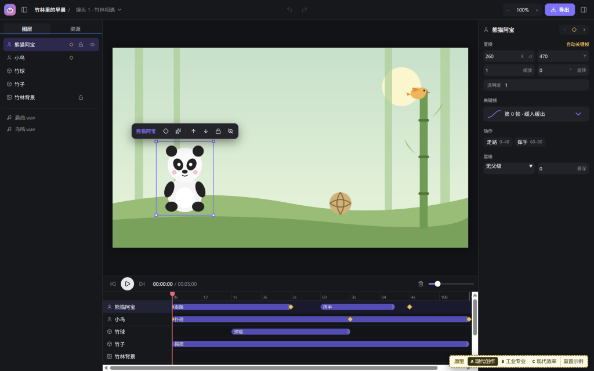
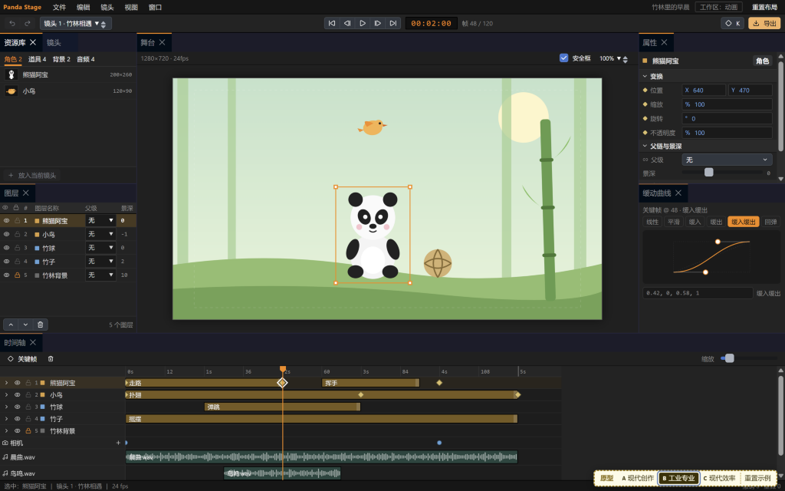
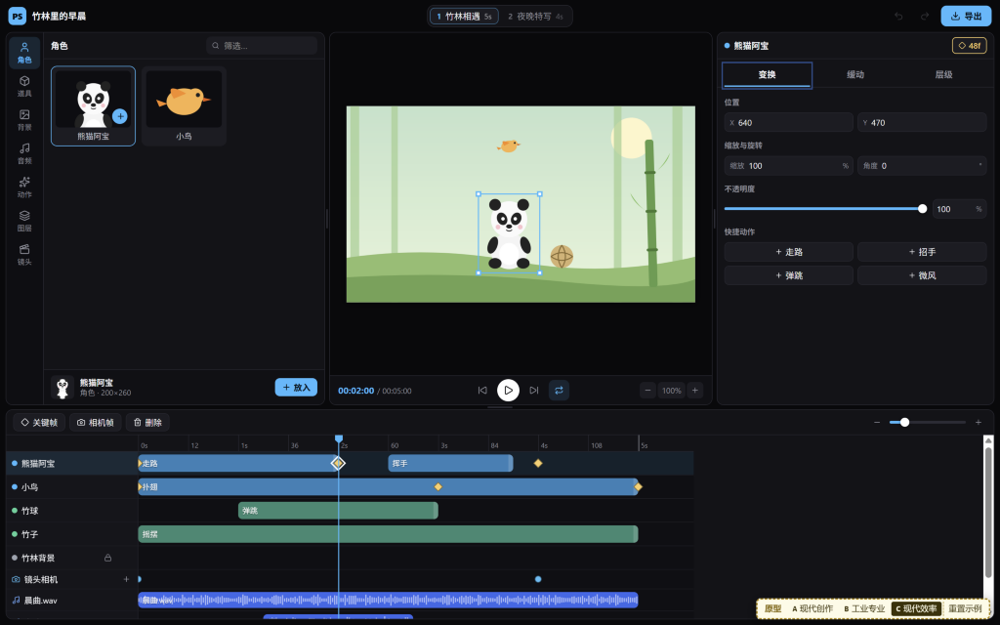
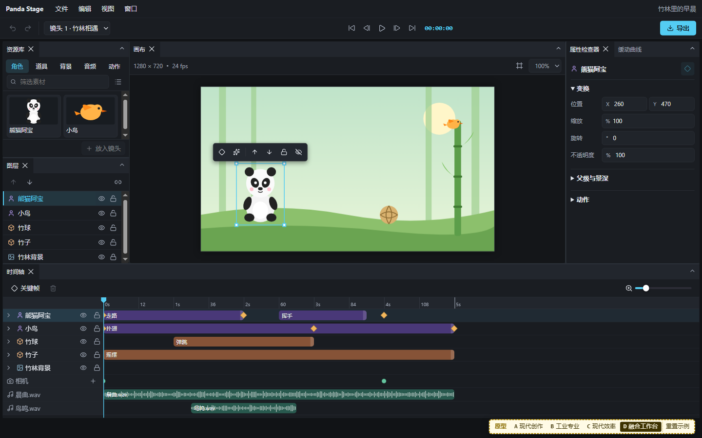

# Project ReShell · 竞争原型 A / B / C 与融合工作台 D

对应 GitHub Issue #1388（A / B / C）和 #1390（D）（独立实验分支 `prototype/reshell-ui2`）。本目录为独立的 React + TypeScript + Vite + Konva 桌面编辑器原型，不修改生产 UI、项目数据模型、IPC/Preload 或现行 `DESIGN.md` / `AGENTS.md`。

## 快速体验（单一启动入口）

```powershell
pnpm --dir prototypes/reshell-ui2 install
pnpm --dir prototypes/reshell-ui2 dev
```

启动后自动打开 `http://localhost:5199/?variant=A`：
- URL 参数切换：`?variant=A` / `?variant=B` / `?variant=C` / [`?variant=D`](http://localhost:5199/?variant=D)
- 页面右下角浮动黄色虚线切换条（刻意独立于产品视觉）：一键在 **A 现代创作 / B 工业专业 / C 现代效率 / D 融合工作台** 间切换并**保留同一份模拟工程状态**，右侧提供「重置示例」按钮。
- 常用快捷键：`Space` 播放/暂停、`←/→` 逐帧、`K` 在播放头添加关键帧、D 中的 `Ctrl+M` 打开导出、`Delete` 删除选中时间轴项、`Ctrl+Z` / `Ctrl+Shift+Z` 撤销重做、画布滚轮缩放、`Alt+左键` 或中键拖动画布平移、时间轴 `Ctrl/Alt+滚轮` 缩放。

## D · 融合工作台（#1390）

- 沿用 B 的 Dockview 工作台。左上资源库、左下图层、中央画布、右侧属性检查器与独立缓动曲线标签、底部全宽时间轴。拖标签可重新停靠，拖分隔线可调整尺寸。面板右上角折叠内容，窗口菜单可开关面板或恢复默认布局。D 的布局单独保存在当前浏览器中，编辑状态由四套原型共享。
- 沿用 C 的中性深色、青蓝强调、素材缩略图、语义片段颜色和 Radix 导出对话框。动作、音频默认列表，角色、道具、背景默认网格。图层轨展开后显示动作、变换和景深，重叠动作可在各自的子轨中操作。
- 复用 A 的对象悬浮工具栏、共享 Konva 舞台和时间轴、Animora 适配的 NumberField 与 EasingEditor，以及 OpenCut 适配的缩放数值控件。数值标签可拖动，Shift 粗调、Alt 微调，一次拖动对应一次撤销。D 的菜单、滑条、右键菜单和提示复用 Radix，图标使用 Lucide。
- 继续使用 MIT 版 Dockview 8.10.0。D 的按钮、选择框、分组和导出进度采用现有轻量控件或原生 HTML。Blueprint 6.23.3 及其 CSS 随 B 按需加载，D 直接打开时无需加载 B；比较过 B 后，其样式会留在当前页面。原版权声明及 [Animora MIT 许可](LICENSES/animora-LICENSE)和 [OpenCut MIT 许可](LICENSES/opencut-LICENSE) 随原型保留。
- 原型使用同一份模拟项目和示例资源。音频以示例波形呈现，口型轨与真实声音、视频导出缺少示例数据或实现，本轮沿用现有模拟边界。Dockview 体验限单个浏览器窗口。
- 在 Windows 上用 Playwright 驱动有界面的 Chrome，走查了 1440×900 和 1280×768 工作台，覆盖素材、图层、画布、数值、曲线、时间轴、播放、镜头、模拟导出、四套方案切换与布局恢复。使用 `pnpm --dir prototypes/reshell-ui2 build` 构建。截图与交互来自浏览器原型，Windows Electron 实机验收待产品阶段。

## A / B / C 对照与供体记录

### A · 现代创作派（Rive / Figma）
- **布局与交互层级**：左侧通高「图层 / 资源」切换面板 + 中间画布优先（选中对象上方悬浮上下文工具栏）与底部紧凑时间轴 + 右侧通高检查器（缓动曲线以 Popover 按需弹出）。
- **实际采用供体与版本**：
  - **Animora**（`itsrajverma/animora` @ `5866ed2193ef19b53986ecfb46164df88134cdbe`，MIT，许可见 `LICENSES/animora-LICENSE`）：直接适配 `src/components/Fields.tsx`（标签拖动调值 + 单手势撤销聚合）与 `src/components/EasingEditor.tsx`（SVG 贝塞尔手柄拖动与预设），产出 [src/donors/NumberField.tsx](src/donors/NumberField.tsx) 与 [src/donors/EasingEditor.tsx](src/donors/EasingEditor.tsx)。
  - **Radix Primitives**（MIT）：`@radix-ui/react-dialog` 1.3.1、`react-popover` 1.3.1、`react-tabs` 1.2.1、`react-tooltip` 1.4.1、`react-context-menu` 2.4.1、`react-dropdown-menu` 2.2.1、`react-slider` 1.6.1。
  - **react-resizable-panels**（MIT）：`4.24.3`（`Group` / `Panel` / `Separator` + 左右面板折叠）。
- **未能复用原因**：Animora 的 `Timeline.tsx` 强耦合其 SVG 矢量文档与 Zustand store，且仅针对 SVG 属性轨，不适合直接搬入 Panda 角色/动作/相机/音频结构，因此时间轴保留共享引擎并做 A 派精简呈现；`react-resizable-panels` v4 的 `Workspace` 仍偏轻量，普通分组分割已满足 A 派需求。
- **大致迁移成本**：中低（Radix + `react-resizable-panels` 与 React 19 / 生产 Konva 兼容顺滑，视觉令牌和 CSS 结构干净）。

### B · 工业专业派（Animate / After Effects / DaVinci Resolve）
- **布局与交互层级**：顶部原生风格菜单栏（文件/编辑/镜头/视图/窗口，可开关任意面板并一键重置布局）+ 高密度工具栏与数码管时码 + **Dockview 7 面板自由停靠/标签页/浮动工作区**（资源库+镜头同组标签、图层表格含父级/景深列、舞台含安全框、属性、独立常驻缓动曲线面板、底部支持展开动作/变换子轨的专业时间轴）+ 底部状态栏。
- **实际采用供体与版本**：
  - **dockview-react**（开源版 `8.10.0`，MIT，未用 Enterprise）：提供面板拖拽停靠、标签页合并、浮窗弹出、`toJSON/fromJSON` 布局持久化与一键重置。
  - **@blueprintjs/core**（`6.23.3`，Apache-2.0）：提供高密度深色菜单、分段控制、滑条、进度条、按钮组与对话框。
  - **Flare**（`Flare-Animate/Flare` @ `f2d08bf4d5bc308ddbb40fa43512e6c122c18e12`，BSD-3-Clause）：仅参考中性深灰层级、单橙色焦点与扁平停靠面板视觉规则，未引入 Rust/egui。
  - **AniCraft**（`storytold/anicraft` @ `259566a0338706a8545b4bc19506ef49c1fbab71`，MIT/Apache-2.0）：仅参考父链下拉选择与景深滑条交互，展示 Panda 既有父级与景深能力，未扩展业务模型。
  - 数值拖动与曲线编辑器复用 `src/donors/NumberField.tsx` / `EasingEditor.tsx`。
- **未能复用 / 兼容记录**：
  - 安装 `dockview` 8.10.0 时发现其仅 re-export `dockview-core`，React 封装组件实际位于 `dockview-react` 8.10.0，已替换为 `dockview-react`。
  - `@blueprintjs/core` 6.23.3 内部依赖的 `react-popper` 2.3.0 声明 peer 依赖 React 16–18，在 React 19.3.1 下实测其 `Popover` 定位异常（下拉菜单锚定在窗口左上角 `(0, 0)`）；因此 B 方案顶部菜单栏与父级/动作下拉菜单已改用 `@radix-ui/react-dropdown-menu` 2.2.1 承载，Blueprint 保留用于按钮组、分段控制、滑条、标签、复选框、进度条与对话框。同时 Blueprint CSS 体积较大（~586 KB），长期维护中需评估是否替换为轻量自研或 Radix 子控件。
- **大致迁移成本**：中高（Dockview 集成顺手且停靠体验强，但 Blueprint 与 React 19 peer 警告及深层样式覆盖在生产长期维护中需评估是否换轻量子控件）。

### C · 现代效率派（CapCut / OpenCut Classic）
- **布局与交互层级**：沿用 OpenCut Classic `apps/web/src/app/editor/[project_id]/page.tsx` 的双层圆角卡片工作台——上层三栏（左侧竖向工作流图标条「角色/道具/背景/音频/动作/图层/镜头」+ 缩略图浏览与底部选中预览条 | 中央舞台与一体式播控栏 | 右侧「变换/缓动/层级」三标签上下文属性），下层通宽多轨时间轴；顶部居中提供镜头条快速切换，右上角直达导出。
- **实际采用供体与版本**：
  - **OpenCut Classic**（`OpenCut-app/opencut-classic` @ `cf5e79e919144200294fb9fed22a222592a0aeea`，MIT，已归档，许可见 `LICENSES/opencut-LICENSE`）：
    - 工作台双层分割拓扑源自 `apps/web/src/app/editor/[project_id]/page.tsx`（移除了 Next.js 路由、EditorProvider、WASM/数据库依赖）。
    - `src/donors/OpenCutControls.tsx` 直接适配 `number-field.tsx`（含分段灵敏度 `scrubAcrossRanges` 与默认值重置按钮）与 `bezier-graph.tsx`（含 0/1 吸附与 Shift 解除吸附）。
  - **react-resizable-panels** `4.24.3`（MIT）+ **Radix Primitives**（Dialog / Tabs / Slider / DropdownMenu，MIT）。
- **未能复用原因**：上游 OpenCut Classic 为 Next.js + Tailwind + Hugeicons + 完整剪辑引擎架构，且项目已归档，故只剥离工作台结构与低耦合控件源码，未搬运其 store、媒体引擎或服务端依赖；`number-field.tsx` 原版使用 `requestPointerLock` 在部分嵌入式 WebView 下不稳定，适配版改用标准 `setPointerCapture` 拖动。
- **大致迁移成本**：低至中（组件剥离后无 Tailwind/Next.js 负担，结构最贴近短动画线性生产流）。

## 共用示例与第三方资产许可核查

- **示例项目**：「竹林里的早晨」（24 fps，1280×720，含 2 个镜头：`镜头 1 · 竹林相遇`、`镜头 2 · 夜晚特写`；角色、道具、背景、相机关键帧与音频波形轨道）。
- **示例素材许可**：`src/core/assets.ts` 中的全部角色、道具、背景矢量图与确定性伪波形均为本原型原创内联 SVG/算法生成，**未引入任何第三方美术或音频文件**，无额外版权负担。
- **开源供体许可证**：Animora 与 OpenCut Classic 原始 `LICENSE` 全文保留在 `LICENSES/` 目录，npm 依赖包许可（MIT / Apache-2.0）随 `package.json` 记录。

## 代表性截图（1440×900 实机运行采集）

> 截图仅作速览，不能代替启动后亲自拖拽画布、时间轴、面板停靠与缓动曲线的实际体验。

| 方案 | 截图 |
|---|---|
| **A · 现代创作派**（Rive / Figma） |  |
| **B · 工业专业派**（Animate / AE / Resolve） |  |
| **C · 现代效率派**（CapCut / OpenCut） |  |
| **D · 融合工作台**（Windows Chrome） |  |
